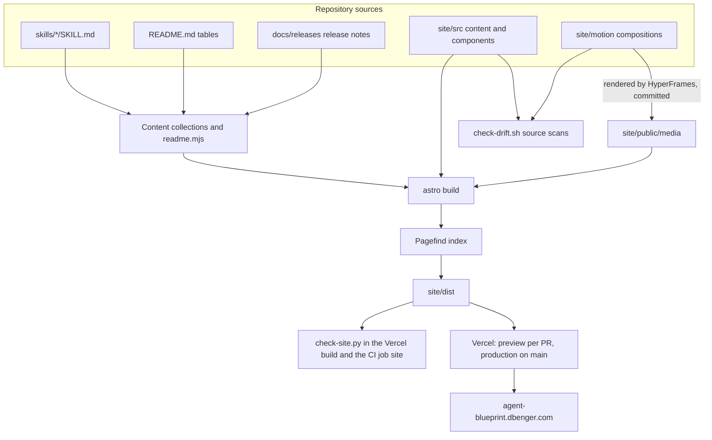
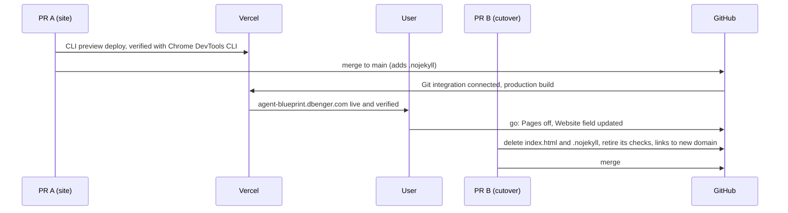

# Agent Blueprint Site Rebuild - Plan

## Goal Capsule

- **Objective:** A developer who opens <https://agent-blueprint.dbenger.com> can install the blueprint in their own coding CLI, find and understand any of the 53 skills, and learn the workflow, and every count, name and command the site shows matches the repository.
- **Means:** a static multi-page Astro site in `site/`, generated from the repository at build time and deployed by Vercel (KTD1, KTD2, KTD3).
- **Authority:** the Key Decisions below, then `AGENTS.md` and its gates, then the approved design sources (KTD10), then this plan's KTDs, then implementer judgment.
- **Stop and ask the user before:** turning off GitHub Pages or changing the repository Website field (U13); creating the Vercel project or attaching the domain if the user is not present (U11); adding anything to the root `package.json` or any external service other than Vercel; changing any skill, `install.sh` or plugin manifest; publishing a claim the repository cannot back.
- **Execution profile:** Deep. Thirteen units in four phases on a feature branch from `main`, shipped as two pull requests (KTD12).
- **Who finishes:** `ce-work` implements and verifies each unit; the standard shipping workflow reviews and merges each pull request; the cutover steps in U13 run only after the user's explicit go.

---

## Product Contract

### Summary

Replace the single-page site with a multi-page site at agent-blueprint.dbenger.com in the approved 2A Drafting Table design, with the path-grid logo and the HyperFrames motion pieces. Skill pages, counts, phases, install routes and release history are generated from the repository, and the gates check the site as they check the README. The old GitHub Pages address is removed once the new site is live.

### Problem Frame

The site today is one 34,000 px page at the repository root, served by GitHub Pages at `ninety2ua.github.io/agent-blueprint`. A developer has to scroll past everything to find one skill, one install step or one release note, and its look (gradient headline, pill badges, a fake terminal window) is the stock pattern of AI-made templates. Its facts are hand-maintained: the drift gate checks counts and grids inside `index.html`, so every skill change means editing a 190 KB file by hand. The redesign exploration (six directions, a hybrid, a motion round and a polish round, all reviewed by the user) produced an approved design and motion set that now needs a real, maintainable build.

### Key Decisions

- **Design: Direction 2A "Drafting Table".** Light technical-drawing language, Archivo and Azeret Mono, zero-chroma off-white, near-black ink, one signal red-orange accent. (session-settled: user-directed — chosen over the 2A + Cyanotype hybrid and five other directions after reviewing live mockups of all of them.) Governs R9.
- **Logo: Direction 4's 3x3 path grid, redrawn in 2A's ink with a red-orange end cell.** (session-settled: user-directed — chosen over the Cyanotype "ab" stamp after comparing both on the same page.) Governs R9.
- **Motion: the HyperFrames film, README hero and four section loops as polished.** (session-settled: user-approved — the user reviewed the renders and the fix round and called them good.) Governs R10.
- **Page types follow skills.addy.ie, without its compare page.** (session-settled: user-directed — the user asked for every page type except compare, with original content.) Governs R1, R3, R5, R7.
- **Host: Vercel at agent-blueprint.dbenger.com.** (session-settled: user-directed — chosen over GitHub Pages: the user moved the site to their own subdomain.) Governs R16.
- **The old address is removed, not forwarded.** (session-settled: user-directed — chosen over a temporary forwarding page: the user wants it gone and accepted that old links return 404.) Governs R17.

### Requirements

**Pages and content**

- R1. The site serves Home `/`, Skills `/skills/` (with a Helper prompts tab), one page per skill `/skills/<name>/`, Docs `/docs/<slug>/` (12 pages), Tutorials `/tutorials/<slug>/` (3), Workflow `/workflow/`, Guides `/guides/<slug>/` (5), Kit `/kit/`, Changelog `/changelog/`, and a 404 page.
- R2. Each skill page shows the skill's summary, when to use it, how to name it in each of the eight tools, its steps, the helper prompts it starts, related skills in its phase, previous and next skill, a link to its `SKILL.md` on GitHub, and the full `SKILL.md` text rendered as plain Markdown.
- R3. The Skills catalog offers text search with a `/` shortcut, phase filter chips with counts for the README's nine phases, a live "N of 53" count, an empty state with a clear action, and a Helper prompts tab listing all 30 helpers.
- R4. Docs pages have a sidebar, on-page contents and previous/next links; a Cmd-K palette searches every page of the site.
- R5. Each tutorial step carries the prompt to paste, what happens, why it matters and a checkpoint, and each tutorial ends with a recap of which skill produced what. Every tutorial is run end to end in a scratch project before its page states what the steps produce.
- R6. The Changelog lists every release from the README release history and `docs/releases/*-release-notes.md`, newest first.
- R7. The Kit page offers the README hero GIF with its Markdown snippet, the film, the four loops, the logo files at several sizes on light and dark, and a copy-ready blurb.
- R8. Every page has a unique title, description, canonical URL and Open Graph tags (one shared social image); the site publishes `sitemap-index.xml` and `llms.txt`.

**Design and motion**

- R9. Every page follows the approved 2A design system, including its theme toggle, and uses the path-grid logo in the header, footer title block and favicon.
- R10. The film (with chapter buttons) appears on Home and Kit and the four loops sit where the approved home page puts them; each video plays only while visible, never autoplays under reduced motion, has a visible pause control and a text alternative. The README shows the new hero GIF.
- R11. Every visible string follows the humanizer and no-ai-slop rules, carries only facts the repository backs, and contains none of the adoption wording `scripts/check-drift.sh` bans. This includes README text rendered on Docs and Guides pages; a sentence that fails is fixed in the README itself.
- R12. Home, Skills, one skill page, one docs page, Kit and Changelog score 100 for Lighthouse Accessibility, Best Practices and SEO on desktop and mobile, log no console errors, and stay under CLS 0.1 and LCP 2.5 s in a mobile performance trace.

**Sync with the repository**

- R13. Skill pages, counts, phases, helper prompts, install routes, naming syntax, support notes, the current version, release history and the bodies of the Docs and Guides pages are generated at build time from `skills/*/SKILL.md`, `README.md`, `.claude-plugin/plugin.json` and `docs/releases/`; none of them is copied by hand into site source. Each Docs and Guides page maps to its README section by heading; only its intro, sidebar position and cross-links are written by hand.
- R14. The gates fail when the site source or the built site claims a count, version or name the repository contradicts, carries banned adoption wording, or is missing a generated page, and the build fails when a README heading that a Docs or Guides page maps to is missing.
- R15. No file named `SKILL.md` exists anywhere outside `skills/<name>/`, build output included, and the root `package.json` is unchanged.

**Hosting and cutover**

- R16. Production serves from `main` at <https://agent-blueprint.dbenger.com>, every pull request gets a preview deployment, and builds are skipped when no site input changed.
- R17. Once the new site is verified live, the old address is gone: the root `index.html` is deleted, GitHub Pages is off, and the repository Website field and every in-repository link point to the new domain.

### Success Criteria

- A newcomer reaches a working install command for their own tool in three clicks or fewer from the home page.
- Adding a skill or editing a `SKILL.md` changes the site on the next build with no edit under `site/` other than re-rendering the README hero GIF, whose skill count the drift gate checks. Renaming or removing a skill also needs edits to the hand-written pages that name it (tutorials, guides, docs, workflow), and the internal-link check in `check-site.py` fails the build and lists those pages until they are updated. A build that cannot generate a page fails instead of shipping a gap.
- The R12 scores hold on the production domain, measured with the Chrome DevTools CLI.

### Scope Boundaries

- No change to any skill, `install.sh`, the plugin manifests or the hooks.
- No analytics, blog, newsletter, accounts or compare page.
- Considered and not built:
  - A forwarding page for the old address: removed by the user's decision; revisit only if the user asks.
  - Hosting media outside the repository (GitHub Release assets fetched at build): not built because the user accepted shipping about 6 MB with installs; revisit if repository size becomes a complaint (see KTD6).
  - WebM or AV1 encodes: MP4 H.264 plays everywhere the site targets; revisit if file size matters.
  - External link checking in CI: internal links are checked (KTD5); revisit if external links rot.
  - Lighthouse CI in the pipeline: the scores are verified by hand per R12; revisit if a regression ships unnoticed.

#### Deferred to Follow-Up Work

- Per-skill social images, `llms-full.txt` and per-page Markdown alternates.
- Re-rendering the README diagram PNGs (`docs/images/*.png`) in the 2A style.
- Refreshing `docs/context/STATUS.md`, which still describes the v4 pull requests as unmerged.

### Open Questions

- Non-blocking, for the user: the approved README hero GIF says "53 skills", so every new skill means a re-render and a new GIF in git history. Default: keep the approved hero and re-render when the count changes, enforced by the drift gate (KTD6). The alternative is to drop the number from the hero line.

### Sources

- Approved design and motion sources, kept outside the repository: `~/projects/claude-eng/site-redesign/` (see its `README.md`; KTD10).
- Comparison page with every direction, the hybrid and the final motion: <https://claude.ai/artifact/VWEvsyfhBd6ixQdszN6jXg>
- Astro 7 upgrade notes (Node 22.12 minimum, Rust compiler, Sätteri Markdown, `compressHTML: 'jsx'`): <https://docs.astro.build/en/guides/upgrade-to/v7/>
- Content Layer glob loader: <https://docs.astro.build/en/reference/content-loader-reference/#glob-loader>
- shadcn base switch to Base UI (2026-07): <https://ui.shadcn.com/docs/changelog>
- Pagefind indexing and JS API: <https://pagefind.app/docs/>
- Vercel monorepo root directory and ignored build step: <https://vercel.com/docs/monorepos> and <https://vercel.com/docs/project-configuration/git-settings#ignored-build-step>

---

## Planning Contract

### Key Technical Decisions

- KTD1. **Astro 7 static site in `site/` with its own `package.json`; shadcn/ui on Base UI for interactive islands only.** Pages render to static HTML; React hydrates only the Cmd-K palette, the mobile menu sheet and the catalog filter. The shadcn CLI v4 default (Base UI) is the actively developed path; `cmdk` drives the palette on any base. The components are restyled with the 2A tokens: zero radius, no shadows, no shadcn colors. (session-settled: user-approved — chosen over reusing the mockups' zero-dependency Python HTML generator: the user asked for shadcn and confirmed the stack call-out.)
- KTD2. **Build-time generation from the repository.** Content collections read `../skills/*/SKILL.md` in place through Astro's `glob()` loader with a base built from `import.meta.url`, validated with `astro/zod`. A small build module (`site/src/lib/readme.mjs`) parses the README's phase tables, install-route table, naming table, support table, helper table and release history into typed data, so the README stays the one checked source for those facts. A parse failure stops the build with the table name in the message. The same module extracts the README sections that Docs and Guides pages map to, using a heading map kept in one data file (`site/src/lib/readme-map.mjs`). Inside an extracted section, links to README anchors become site URLs, links to repository files become GitHub links, and referenced images are copied into the build. A mapped heading that no longer exists stops the build and names the page. (session-settled: user-approved — skill pages generated from each `SKILL.md` and the README tables, confirmed in the scope call-outs.) Covers R13.
- KTD3. **Vercel Git integration with a new project named `agent-blueprint`, Root Directory `site/`.** The team already has an unused project named `site`, so the new one gets a distinct name. Framework preset Astro, no adapter, Node 24.x (the team default; Astro needs 22.12 or later). Files outside the root directory stay readable at build time (Vercel's default for new projects). Preview protection (Vercel Authentication) is turned off, because the site is public and the preview checks in U11 need to load it.
  - `site/vercel.json` sets cache headers: long-lived for hashed assets, a shorter cache for `/media/`.
  - An ignore-build script (`site/scripts/ignore-build.sh`) skips the build only when nothing under `site/`, `skills/`, `docs/releases/`, `README.md` or `.claude-plugin/plugin.json` changed since `VERCEL_GIT_PREVIOUS_SHA`. It uses `:/` pathspecs so it works from the root directory, and it fails open: it builds when that variable is empty or the commit is missing from Vercel's shallow clone.
  - Until PR A merges, previews are deployed with the Vercel CLI from the branch. The Git integration is connected when PR A merges, so pushes to `main` never build before `site/` exists.
  - The domain is attached with the Vercel CLI; `dbenger.com` already uses Vercel DNS in the same team. (session-settled: user-directed — chosen over GitHub Pages: the user moved the site to their own subdomain.) Covers R16.
- KTD4. **No literal counts in site source.** Counts, versions and lists come from generated data, never typed into `.astro`, `.md` or `.mjs` files. Hand-written Markdown never states a count; a page that needs one renders it through an `.astro` component fed by data. The drift gate's scan of `site/src/` enforces this, and the built HTML is checked as well (KTD5). Covers R13, R14.
- KTD5. **Gates check the built site, in CI and in the deploy build.** `scripts/check-site.py` (standard library only) checks `site/dist`:
  - one page per skill folder and one helper entry per helper prompt in the tree;
  - every current-state claim equals the tree: the generator marks them with a `data-claim` attribute (skills, helper prompts, hook handlers, coding CLIs, version), so historical text such as the v4.0.0 release notes on the Changelog is never flagged;
  - no file named `SKILL.md`;
  - none of the banned adoption wording;
  - every internal link resolves;
  - every page has a title, description and canonical URL.
  The Vercel build command runs it after `astro build`, so a failing check fails the deployment and never reaches production; `main` has no branch protection to stop that otherwise. A new `site` job in `.github/workflows/ci.yml` runs on every pull request on purpose, because skills are build inputs. It sets up Node 24 with npm caching on `site/package-lock.json` and `permissions: contents: read`, then runs `npm ci`, `astro check`, the build, the data-module tests and `check-site.py`. The adoption denylist moves out of `scripts/check-drift.sh` into `scripts/adoption-denylist.json`, read by both gates. `check-drift.sh` extends its denylist scan to `site/src/` and `site/motion/`. Its literal-count scan covers `site/src/` and the film and loop compositions in `site/motion/`, for skill, helper-prompt and hook counts. It excludes `site/motion/readme-hero/`, whose approved "N skills" claim the moved hero check compares with the tree. It also gains one README invariant: every skill folder appears in exactly one phase table, so people editing only skills see that failure without Node. Covers R14, R15.
- KTD6. **Media committed once in the repository.** MP4s and posters live in `site/public/media/`, the HyperFrames compositions and their render notes in `site/motion/`, and the new README hero GIF replaces `docs/images/hero.gif`. The drift gate's hero count check moves from `docs/images/hero/hero.html` to the README hero composition. (session-settled: user-approved — the user accepted that `site/` and about 6 MB of media ship with every plugin install, chosen over a separate site branch.) Conflict call-out: research found that every re-render stays in git history for good and that Codex and Antigravity installs from a checkout copy `.git` too. Commit re-renders only when a video's content changes. Keep counts out of the film and the loops so a new skill does not force a re-render of them; the README hero keeps its approved count (Open Questions). If growth becomes a problem, switch to fetching media from a GitHub Release at build time.
- KTD7. **Tabs, copy buttons, the video player and the theme toggle are small vanilla scripts.** Tabs follow the ARIA tabs pattern and render every panel in the static HTML, with inactive panels hidden, so every tool's commands are searchable. A `<noscript>` style in the base layout shows every panel, each labelled with its tool name, and hides the inert tab buttons, so the commands are readable without JavaScript while visitors with JavaScript see no layout shift. Keeping them out of React avoids hydrating an island on all 53 skill pages (KTD1, R12). The approved mockups' scripts are the reference; the theme toggle's first-paint script is inline. Covers R2, R10.
- KTD8. **Search with Pagefind through `astro-pagefind`, pinned.** It is a third-party integration on a new Astro major; if it breaks, run the `pagefind` command against `site/dist` after the build instead. Every content template carries `data-pagefind-body` and a section filter. The Cmd-K palette (shadcn Command in a Dialog, hydrated `client:idle`) queries the Pagefind JS API. Pin the `cmdk` version and verify `aria-activedescendant` stays on the input. Covers R4.
- KTD9. **Fonts self-hosted through Astro's Fonts API with the local provider.** Archivo is the variable file with its width axis; Azeret Mono covers the weights the design uses. This removes the Google Fonts request.
- KTD10. **The approved sources are the visual spec.** `~/projects/claude-eng/site-redesign/f/` (home, Kit, tokens, logo SVGs, interaction scripts), `d2/` (the skill page), `h/changelog.html` (the changelog layout) and `m/` (motion) are ported into Astro components. Their copy, already checked against the copy rules, is the starting copy. Anything the mockups do not cover (docs pages, tutorials, guides) extends the same tokens and components.
- KTD11. **Record the dependency boundary.** `docs/learnings/2026-10-portability-decision.md` keeps "zero dependency" for the plugin. A new record, `docs/learnings/2026-10-site-rebuild-decision.md`, scopes it: `site/` is a maintainer-only build whose dependencies live only in `site/package.json`. It also records the Vercel host, the dropped old address and the generation sources. It states that changes under `site/` and to README media are not plugin content for the version-bump rule, because no installed skill or hook changes with them. `AGENTS.md` gains:
  - the `site/` folder in its layout;
  - the new gate in its table, with a note that it needs Node 22.12 or later locally;
  - a note to install the plugin locally from a clean checkout or worktree, since the Codex plugin route and Antigravity copy ignored files such as `site/node_modules`.
- KTD12. **Two pull requests, with Pages turned off between them.** PR A adds the site, media, gates and README hero, plus an empty `.nojekyll` at the root so the legacy Pages build stops rendering the new Markdown under `site/`. `index.html` and its gate checks stay in place. Merging PR A, connecting the Git integration and attaching the domain put production live. After the user's go, Pages is turned off. Then PR B deletes `index.html`, `.nojekyll` and the `index.html` gate checks and tests, and points links at the new domain. This order means the old page is never removed before the new one is verified, and the old address never falls back to serving `README.md` as its home page. Rollback is Vercel's Instant Rollback to the previous production deployment; turning Pages back on is a manual API call and is not part of reverting PR B. (session-settled: user-directed — chosen over a temporary forwarding page: the user wants the old address gone and accepted that old links return 404.) Covers R17.

### High-Level Technical Design

How the repository becomes the site, and where each check sits:



Cutover order across the two pull requests:



### Output Structure

```text
site/
  package.json, package-lock.json, astro.config.mjs, tsconfig.json, components.json, vercel.json
  scripts/ignore-build.sh
  public/brand/        mark.svg, mark-negative.svg, mark-small.svg, favicon.svg, og.png
  public/media/        film.mp4, film.jpg, film-1280.jpg, film-chapters.json, loop-*.mp4, loop-*.jpg, readme-hero.mp4
  public/fonts/        Archivo variable, Azeret Mono
  motion/              HyperFrames compositions (film, readme-hero, four loops) and RENDER.md
  src/content.config.ts
  src/lib/             readme.mjs, skills.mjs, site.mjs
  src/content/         docs/*.md, tutorials/*.md, guides/*.md
  src/components/      layout, drafting primitives, cards, tabs, video figures
  src/components/ui/   shadcn components (command, dialog, sheet, toggle-group)
  src/layouts/         BaseLayout.astro, DocsLayout.astro
  src/pages/           index, skills/index, skills/[name], docs/[...slug], tutorials, workflow, guides, kit, changelog, 404, llms.txt
  src/styles/          tokens.css, global.css
  test/                readme.test.mjs, skills.test.mjs
scripts/check-site.py, scripts/adoption-denylist.json
```

### Implementation Constraints

- Site dependencies go only in `site/package.json`; the root `package.json` is Pi's manifest and must not change (R15).
- Nothing the build or the shadcn CLI writes may land at a root component path (`agents/`, `commands/`, `hooks/hooks.json`, `.mcp.json`, `rules/`); keep `components.json` and every config inside `site/`.
- Write every hand-written link as a root-relative path; there is no base path on Vercel.
- `.gitignore` already ignores any folder named `dist/` or `build/`; add `site/.astro/` and `site/node_modules/`, and do not name a route folder `build`.
- Render `SKILL.md` bodies as plain Markdown, not MDX: two skills contain bare placeholders such as `<base-branch>` that MDX cannot parse. Escape raw HTML in those bodies too, or placeholders such as `<base-branch>`, `<name>` and `<path>` in prose render as unknown elements and their text disappears.
- Astro 7's `compressHTML: 'jsx'` default can glue inline text together; check text-heavy pages visually after the first production build.
- `markdownlint` in CI lints `site/**/*.md` with the repository's `.markdownlint.json`; content files must pass it.

### System-Wide Impact

- **Plugin installs.** Claude Code, Cursor CLI and Amp install the tracked tree, so they gain `site/` and its media (about 6 MB). None of the eight hosts reads anything under `site/`, as long as nothing lands at a root component path (Implementation Constraints). Codex and Antigravity installs from a checkout copy `.git` as well, so every committed re-render stays in those copies (KTD6). Grok Build, Pi and Hermes receive only `skills/` from `install.sh`, which is unchanged.
- **Pi.** Pi installs the dependencies of the root `package.json` on git installs; that file stays unchanged (R15), so Pi users pull no site dependencies.
- **CI.** The new `site` job adds a Node install and a build to every pull request. It needs no secrets, because Vercel builds through its Git integration rather than from CI. The existing jobs are unchanged apart from the drift gate's wider scan and the shellcheck list.
- **Gate tests.** `run_drift_with()` in `tests/gates/test_prompt_files.py` copies the repository about 15 times per run and ignores only `.git` and `node_modules`. A local `site/dist` or `site/.astro` would be copied each time, so U10 adds both to its ignore pattern.
- **Hooks.** The prompt-guard hook runs its advisory scan on writes to paths containing `docs/`, which includes `site/src/content/docs/`; it never blocks.
- **README.** The hero GIF changes and the overview GIF goes (U12); the link to the new site arrives with the cutover (U13).
- **Maintainers.** Building the site locally needs Node 22.12 or later. Re-rendering media needs HyperFrames and ffmpeg, as `site/motion/RENDER.md` describes. Nothing changes for working on skills.

### Risks & Dependencies

| Risk or dependency | Decision |
|---|---|
| Astro 7 is three months old: a stricter Rust compiler, a new Markdown processor and `compressHTML: 'jsx'` | Pin exact versions in `site/package-lock.json`; treat a framework bug as a blocker to report, not a reason to switch frameworks; check text-heavy pages visually (Implementation Constraints) |
| shadcn on Base UI has fewer community examples than Radix, and `cmdk` 1.1.1 has a reported stale `aria-activedescendant` bug | Pin `cmdk`; U7's accessibility-tree check proves the palette before it ships |
| The Vercel GitHub app may not have access to `Ninety2UA/agent-blueprint` | U11 runs with the user present to grant it; this is a stop condition in the Goal Capsule |
| A README edit can break the README parser and therefore the site build | The parser names the broken section (KTD2), and the `site` CI job runs on every pull request, so the break fails before merge |
| Re-rendered media grow git history for good | KTD6's commit rule; the Release-asset fallback is recorded under Scope Boundaries |
| Tutorials need real agent runs, which take time and tokens, and some skills stop to ask for approval | U8 runs them live with a person answering the approvals; the unattended run uses a throwaway private GitHub repository that is deleted afterwards (deleting it needs the `gh` token's `delete_repo` scope) |
| Byte-range support for video seeking on Vercel is not documented | A static file on `dbenger.com` already answers range requests with 206; U11 re-checks on the preview |
| Vercel Hobby plan limits (100 GB a month of transfer, one concurrent build) | Ample for a static site with about 6 MB of media; the site takes no payments, so the commercial-use terms do not apply |
| Old links to the Pages address return 404 after cutover | Accepted by the user (Key Decisions) |
| The Vercel build image may lack `python3`, which the build command needs for `check-site.py` | U11 confirms it on the first CLI preview; if it is missing, require the CI `site` check through Vercel Deployment Checks instead |
| A bad production deployment | Vercel Instant Rollback (KTD12) |

---

## Implementation Units

| U-ID | Title | Key files | Depends on |
|---|---|---|---|
| U1 | Scaffold the site and import approved assets | `site/` config, `site/public/`, `site/motion/`, `.gitignore` | none |
| U2 | Generate site data from the repository | `site/src/content.config.ts`, `site/src/lib/*.mjs`, `site/test/` | U1 |
| U3 | Layout shell and design system | `site/src/layouts/`, `site/src/components/`, `site/src/styles/` | U1 |
| U4 | Home page with motion | `site/src/pages/index.astro`, video components | U2, U3 |
| U5 | Skills catalog and skill pages | `site/src/pages/skills/` | U2, U3 |
| U6 | Docs section | `site/src/content/docs/`, `site/src/pages/docs/` | U2, U3 |
| U7 | Search and Cmd-K palette | `site/src/components/ui/`, Pagefind config | U4, U5, U6 |
| U8 | Tutorials, Workflow and Guides | `site/src/content/tutorials/`, `guides/`, `site/src/pages/workflow.astro` | U3, U5 |
| U9 | Kit, Changelog, 404, llms.txt and metadata | `site/src/pages/kit.astro`, `changelog.astro`, `404.astro`, `llms.txt.ts` | U2, U3, U4 |
| U10 | Gates and CI for the site | `scripts/check-site.py`, `scripts/check-drift.sh`, `scripts/adoption-denylist.json`, `.github/workflows/ci.yml`, `tests/gates/` | U2, U9 |
| U11 | Vercel project, previews and verification | `site/vercel.json`, `site/scripts/ignore-build.sh`, `.github/workflows/ci.yml` | U7, U8, U10, U12 |
| U12 | README hero, docs and learnings | `README.md`, `docs/images/hero.gif`, `AGENTS.md`, `docs/learnings/` | U1, U10 |
| U13 | Production cutover and old address removal | `index.html`, `scripts/check-drift.sh`, `tests/gates/`, `README.md` | U11, U12 |

### Phase 1: Foundation

### U1. Scaffold the site and import approved assets

- **Goal:** An Astro 7 project in `site/` that builds an empty page, with the approved logo files, fonts, media and motion sources in place.
- **Requirements:** R9, R10, R15; KTD1, KTD6, KTD9, KTD10.
- **Dependencies:** none.
- **Files:**
  - Create: `site/package.json`, `site/package-lock.json`, `site/astro.config.mjs`, `site/tsconfig.json`, `site/components.json`
  - Create: `site/public/brand/` (logo SVGs from the approved `f/` folder, a 1200x630 `og.png` drawn in 2A style)
  - Create: `site/public/media/` (the renders from the approved `m/out/`)
  - Create: `site/public/fonts/`
  - Create: `site/motion/` (the compositions from `m/src/` and a `RENDER.md` with the re-render commands)
  - Modify: `.gitignore`
- **Approach:**
  1. Scaffold with the official Astro CLI, then add React, Tailwind (through `astro add`), sitemap and `astro-pagefind`; initialize shadcn with the default Base UI base (KTD1).
  2. Configure `site` as `https://agent-blueprint.dbenger.com` with no base path, and the Fonts API with the local provider (KTD9).
  3. Copy the approved logo SVGs, renders and compositions; drop the `.bak` file and scratch outputs.
- **Patterns to follow:** the approved `f/src/` build for token names; `m/out/NOTES.md` for render settings.
- **Test expectation:** none -- scaffolding; the proof is that `astro build` succeeds and the root `package.json` is byte-identical.
- **Verification:**
  - `astro build` in `site/` produces `site/dist/index.html`.
  - All repository gates still pass.
  - `git status` shows nothing new at the repository root besides `site/` and the `.gitignore` change.
  - No installed npm package under `site/node_modules` ships a file named `SKILL.md`; `check-portability.py` skips `node_modules`, so this is checked once by hand here.

### U2. Generate site data from the repository

- **Goal:** Typed data for skills, phases, helpers, install routes, naming syntax, support notes and releases, built from the repository at build time.
- **Requirements:** R2, R3, R6, R13; KTD2, KTD4.
- **Dependencies:** U1.
- **Files:**
  - Create: `site/src/content.config.ts`, `site/src/lib/readme.mjs`, `site/src/lib/readme-map.mjs`, `site/src/lib/skills.mjs`, `site/src/lib/site.mjs`
  - Modify: `README.md` (add the v4.0.1 and v4.0.0 rows, both dated 2026-10-07 from their tags, at the top of the release-history table, and rename its summary to cover v2.3 to v4.0.1)
  - Test: `site/test/readme.test.mjs`, `site/test/skills.test.mjs` (Node's built-in test runner, no extra dependency)
- **Approach:**
  1. A `skills` collection reads `../skills/*/SKILL.md` with a `glob()` base built from `import.meta.url`; the schema requires `name` and `description` and passes other fields through.
  2. `readme.mjs` parses the README sections by heading. It covers the nine phase tables under "Skills reference", the install table and "How to name a skill" table under "Install", the support table, the helper table and the release history table. Each parser returns plain data and throws with the section name when a table is missing or malformed.
  3. `skills.mjs` joins the two sources: each skill gets its phase, its helpers (from `skills/<name>/references/agents/*.md`, companion notes excluded the way `check-drift.sh` excludes them), its related skills and its neighbors.
  4. The README release-history table is the one source of versions and dates. `docs/releases/v4.0.0-release-notes.md` and `docs/releases/v4.0.1-release-notes.md` supply only the detailed v4 entry bodies; GitHub Release bodies are never read.
- **Execution note:** Build the README parser test-first against the real README and a broken copy.
- **Patterns to follow:** the companion-note exclusion loop in `scripts/check-drift.sh`; the table shapes in `README.md`.
- **Test scenarios** (expected counts and versions are derived from the tree and `.claude-plugin/plugin.json`, never typed into the tests, so adding a skill or cutting a release needs no test edit):
  - Parsing the real README yields nine phases whose skill lists cover every folder under `skills/` exactly once.
  - Parsing the real README yields one helper row per helper prompt file in the tree, each linking to an existing file.
  - The naming table yields `/` for Claude Code, `$` for Codex, `/skill:` for Pi and plain words for Amp.
  - A README with the "Skills reference" heading removed makes the parser throw an error that names the missing section.
  - A skill folder absent from every phase table makes the join throw and name the folder.
  - The release history's first entry is the version in `.claude-plugin/plugin.json`, and its dates match the README table.
  - Every heading in the README map resolves to a section of the real README.
  - A README copy with a mapped heading renamed makes extraction throw and name the page that maps to it.
  - Inside an extracted section, a link to a README anchor such as `#install` becomes the matching site URL, and a link into `skills/` becomes a GitHub link.
- **Verification:** the tests pass, and the generated data agrees with the drift gate's own counts for skills and helper prompts.

### U3. Layout shell and design system

- **Goal:** Shared layouts and components that reproduce the approved 2A design on every page.
- **Requirements:** R9, R10, R11, R12; KTD1, KTD7, KTD10.
- **Dependencies:** U1.
- **Files:**
  - Create: `site/src/styles/tokens.css`, `site/src/styles/global.css`
  - Create: `site/src/layouts/BaseLayout.astro`, `site/src/layouts/DocsLayout.astro`
  - Create: `site/src/components/` (header with nav, footer title block, theme toggle, mobile menu sheet island, drafting primitives (sheet frame, dimension line, registration mark), copy button, tabs, video figure, film player)
  - Create: `site/src/components/ui/` (shadcn `sheet`, `dialog`, `command`, `toggle-group`, restyled)
- **Approach:**
  1. Port the OKLCH tokens and type scale from the approved `f/src/base.css` into `tokens.css`. Map them onto the shadcn variable names with `--radius: 0` and no shadow utilities.
  2. The header carries the nav (Skills, Docs, Tutorials, Workflow, Guides, Kit, Changelog, GitHub, Get started) with the active section marked on child pages.
  3. Tabs render every panel into static HTML (KTD7).
  4. The video figure and film player port the approved `f/src/video.js` behavior. That covers play only while at least half visible, no autoplay under reduced motion, a visible pause control, chapter buttons that seek and mark the current chapter, a progress line and a text alternative.
- **Patterns to follow:** the approved `f/src/` (`base.css`, `common.js`, `video.js`, `parts.py`, `svg.py`); `d2/` for the skill-page drafting primitives.
- **Test scenarios:**
  - With JavaScript off, every tab panel is visible on the rendered page with its tool name, not only present in the HTML.
  - With JavaScript on, the inactive panels stay hidden from first paint, so the page shows no layout shift.
  - Under emulated `prefers-reduced-motion: reduce`, no video starts on its own and each shows its poster with a play control.
  - A loop scrolled out of view pauses; scrolled back to at least half visible, it resumes.
  - Clicking a chapter button seeks the film to that chapter's start time from `film-chapters.json` and marks that chapter as current.
  - The theme toggle persists across a reload, and the first paint uses the stored theme without a flash.
  - At 390 px the mobile menu opens, traps focus, closes on Escape and returns focus to its button.
- **Verification:**
  - A scratch page using every component matches the approved mockup at 1440 and 390 px in light and dark.
  - The console is empty in the Chrome DevTools CLI.

### Phase 2: Pages

### U4. Home page with motion

- **Goal:** The approved 2A home page, generated from site data, with the film and loops in place.
- **Requirements:** R1, R9, R10, R11; KTD4, KTD10.
- **Dependencies:** U2, U3.
- **Files:**
  - Create: `site/src/pages/index.astro`, home section components under `site/src/components/home/`
- **Approach:**
  1. Port each section of the approved `f/index.html` in order: hero schematic, the problem, Detail A stations with the waves loop in Build, the film section, the catalog preview, why it holds up with the review and handoff loops, the unattended-runs spotlight with the runner loop, install by tool, closing call to action.
  2. Every count, skill name and command comes from U2 data (KTD4).
  3. The film section reads its chapters from `film-chapters.json` and uses `film-1280.jpg` as its poster.
- **Patterns to follow:** the approved `f/index.html` and `f/src/home.py`, `home.css`, `home.js`.
- **Test scenarios:**
  - The built home page names 53 skills, 30 helper prompts and 10 hook handlers, each taken from data.
  - The install-by-tool tabs show each tool's command from the README install table, and the Codex tab names skills with `$`.
  - The film's chapter buttons match `film-chapters.json` in label and start time.
- **Verification:** the built page matches the approved mockup at 1440 and 390 px, and the copy audit (R11) passes on its visible text.

### U5. Skills catalog and skill pages

- **Goal:** The catalog and one generated page per skill.
- **Requirements:** R1, R2, R3, R13; KTD2, KTD7.
- **Dependencies:** U2, U3.
- **Files:**
  - Create: `site/src/pages/skills/index.astro`, `site/src/pages/skills/[name].astro`, catalog filter island under `site/src/components/skills/`
- **Approach:**
  1. `getStaticPaths` emits one page per skill folder name.
  2. Each skill page follows the approved Direction 2 skill page: header, "name it in your tool" tabs, steps from the `SKILL.md` headings, helpers, what you get back where the skill defines it, related skills, previous and next, the GitHub link, then the full `SKILL.md` body as plain Markdown. Most skills have no `references/agents/` folder; for those, the helpers section and its contents entry are left out, as optional sections are.
  3. The catalog filter is a shadcn toggle-group island with a text input. It supports the `/` shortcut, guarded when another input has focus, a live count, an empty state and a filter state kept in the URL (`phase` and the search text as `q`) so both survive back and forward.
  4. The Helper prompts tab groups the 30 helpers by owning skill.
- **Patterns to follow:** the approved `d2/skill.html`; Direction 4's skill finder in `d4/` for the filter interaction.
- **Test scenarios:**
  - The build emits exactly one page per folder in `skills/`, at `/skills/<folder name>/`.
  - The `ab-review-swarm` page lists the reviewer prompts found under its `references/agents/`.
  - The `ab-finishing-a-development-branch` page shows the placeholder text `<base-branch>` as visible text, not as a swallowed element.
  - Typing `review` filters the catalog to the skills whose name or summary contains it and updates the count.
  - A filter with no matches shows the empty state, and its clear action restores all 53.
  - Opening `/skills/?phase=quality` shows only Quality skills with that chip selected, and Back restores the previous state.
  - Typing `review`, then selecting the Quality chip, then pressing Back restores both the typed text and the chip together.
  - A skill with no files under `references/agents/` renders its page without a helpers section or contents entry.
  - Pressing `/` while the search box is not focused focuses it; pressing `/` inside another input types the character.
- **Verification:** `check-site.py` (U10) finds 53 skill pages and 30 helper entries, and no file named `SKILL.md` exists in `site/dist`.

### U6. Docs section

- **Goal:** Twelve docs pages with sidebar, on-page contents and previous/next links.
- **Requirements:** R1, R4, R11, R13.
- **Dependencies:** U2, U3.
- **Files:**
  - Create: `site/src/content/docs/` (the hand-written intro for each of getting-started, quick-start, update, upgrade-from-v3, project-files, customization, how-it-works, hooks-and-native-features, consistency-gates, error-recovery, tested-in-each-tool, faq)
  - Create: `site/src/pages/docs/[...slug].astro`, sidebar and contents components
- **Approach:**
  1. Each page renders the README section it maps to through U2's README map (R13), under a short hand-written intro, and links to the matching `docs/hosts/*.md` or `docs/upgrade/v4.md` on GitHub where one exists.
  2. Tables of facts (install routes, naming, support) render from U2 data, not from Markdown copies.
  3. Getting started opens on install tabs per tool, each linking to that tool's host doc on GitHub.
  4. The sidebar order is curated in one data file; previous and next follow it.
- **Patterns to follow:** Direction 4B's docs portal in `d4/` for sidebar and contents layout, in 2A tokens.
- **Test scenarios:**
  - Each docs page appears once in the sidebar, and previous/next walk the sidebar order end to end.
  - Getting started shows a tab for each of the eight tools, with the command from the README install table.
  - Changing a sentence in the README's FAQ section changes the FAQ page on the next build with no edit under `site/`.
  - The on-page contents lists each H2 on the page and links to its anchor.
- **Verification:**
  - `markdownlint` passes on `site/src/content/docs/`.
  - The copy audit passes.
  - Every fact on the pages traces to a README section or a host doc.

### U7. Search and Cmd-K palette

- **Goal:** Site-wide search from any page.
- **Requirements:** R4, R12; KTD8.
- **Dependencies:** U4, U5, U6.
- **Files:**
  - Create: `site/src/components/ui/command.tsx` (restyled), `site/src/components/search/CommandPalette.tsx`
  - Modify: `site/astro.config.mjs` (Pagefind integration), content templates (`data-pagefind-body`, section filters)
- **Approach:**
  1. Index every content template with a section filter (Skills, Docs, Tutorials, Guides, Pages).
  2. The palette opens on Cmd-K or Ctrl-K and from the header search button. It queries the Pagefind JS API on input, groups results by section, and loads the index lazily on first open.
- **Patterns to follow:** the ⌘K palettes in the approved mockups for look and keyboard behavior.
- **Test scenarios:**
  - Searching `review swarm` returns the `ab-review-swarm` skill page first.
  - A query with no results shows a "no results" line rather than an empty list.
  - Opening the palette before the index loads shows a loading line, then results without retyping.
  - Arrow keys move the active option, `aria-activedescendant` on the input names it, Enter opens it, and Escape closes the palette and returns focus.
  - Hidden tab panels are searchable: searching `cursor-agent` finds the page whose install tab holds it.
- **Verification:** keyboard-only and screen-reader checks in the Chrome DevTools accessibility tree, with no console errors.

### U8. Tutorials, Workflow and Guides

- **Goal:** Three hands-on tutorials, the workflow concept page and five guides.
- **Requirements:** R1, R5, R11.
- **Dependencies:** U3, U5.
- **Files:**
  - Create: `site/src/content/tutorials/` (first-feature-new-project, feature-existing-codebase, unattended-run), `site/src/pages/tutorials/`
  - Create: `site/src/content/guides/` (unattended-runs, team-work-and-swarms, model-and-effort, knowledge-compounding, session-continuity), `site/src/pages/guides/`
  - Create: `site/src/pages/workflow.astro`
- **Approach:**
  1. Workflow presents the loop, the four pipelines and the quality gates with the 2A drawing components.
  2. Each guide renders the README section it maps to through U2's README map (R13), under a short hand-written intro, with links to the owning skill pages.
  3. Each tutorial is run first in a fresh scratch git repository outside this one, in a live Claude Code session with the plugin installed. A person answers the approval prompts that skills such as `ab-brainstorming` raise. The page is then written from what the run produced: real file paths, real outputs, real checkpoints. Run notes go in PR A's description, not in the repository.
  4. The unattended tutorial runs `skills/ab-ship-pipeline/scripts/run.sh` end to end against a throwaway private GitHub repository on the user's account, created for the run and deleted afterwards (the user approved this approach). The run goes through the secret scan, the push and the pull request, and the observed publishing result goes in PR A's run notes before the page's publishing steps and checkpoint are written.
  5. Step skill chips link to the skill pages.
- **Execution note:** Run each tutorial before writing its page; the run's transcript is the evidence for every "what happens" line.
- **Test scenarios:**
  - Every skill chip in a tutorial links to an existing skill page.
  - Each tutorial's recap table names only skills that appear in its steps.
- **Verification:**
  - Each tutorial's claims match its recorded scratch run.
  - The copy audit passes.
  - `markdownlint` passes.

### U9. Kit, Changelog, 404, llms.txt and metadata

- **Goal:** The remaining pages and the metadata every page needs.
- **Requirements:** R1, R6, R7, R8; KTD2.
- **Dependencies:** U2, U3, U4.
- **Files:**
  - Create: `site/src/pages/kit.astro`, `site/src/pages/changelog.astro`, `site/src/pages/404.astro`, `site/src/pages/llms.txt.ts`
  - Modify: `site/src/layouts/BaseLayout.astro` (title, description, canonical, Open Graph)
- **Approach:**
  1. Kit ports the approved `f/kit.html`, with file sizes read from the files at build time.
  2. Changelog ports the revision-block layout from `h/changelog.html` and renders U2's release data.
  3. 404 offers Home and Skills.
  4. `llms.txt` lists the site sections and every skill page with its one-line summary.
- **Patterns to follow:** the approved `f/kit.html`, `h/changelog.html`.
- **Test scenarios:**
  - The Changelog lists every version in the README release history, newest first, with matching dates.
  - The Kit page's file sizes equal the sizes of the files in `site/public/media/`.
  - `llms.txt` contains one line per skill page and per section index.
  - Two pages never share a title or description.
- **Verification:** the built `404.html`, `sitemap-index.xml` and `llms.txt` exist, and the sitemap lists every page.

### Phase 3: Checks and hosting

### U10. Gates and CI for the site

- **Goal:** The gates catch drift on the site as they do on the README.
- **Requirements:** R14, R15; KTD4, KTD5.
- **Dependencies:** U2, U9.
- **Files:**
  - Create: `scripts/check-site.py`, `scripts/adoption-denylist.json`
  - Modify: `scripts/check-drift.sh`, `.github/workflows/ci.yml`
  - Test: `tests/gates/test_check_site.py`
  - Modify tests: `tests/gates/test_prompt_files.py`, `tests/gates/test_orchestrate.py`
- **Approach:**
  1. Move the adoption phrases into `scripts/adoption-denylist.json`, read by `check-drift.sh` and `check-site.py`. Keep the companion-note loop in `check-drift.sh` byte-identical, because `tests/gates/test_prompt_files.py` extracts it by regex.
  2. Extend `check-drift.sh` to scan `site/src/` and `site/motion/` for the denylist and for literal count claims with the README hero excluded (KTD4, KTD5), and add the README invariant that every skill folder appears in exactly one phase table (KTD5). Move the hero count check to `site/motion/readme-hero/`. Leave the `index.html` checks in place until U13.
  3. `check-site.py` takes a dist folder and runs the KTD5 checks, exiting 0, 1 or 2 like the other gates. Only elements marked with `data-claim` count as current-state claims.
  4. Set `site/package.json`'s build script to run `check-site.py` after `astro build`, so the Vercel build fails on a failing check (KTD5).
  5. Add the `site` CI job (KTD5). The shellcheck entry for `site/scripts/ignore-build.sh` arrives with the script in U11.
  6. Add `site/src` and `site/motion` to `SURFACES` in `test_orchestrate.py`, and add `dist` and `.astro` to the ignore pattern of `run_drift_with()` in `test_prompt_files.py`.
- **Execution note:** Write `test_check_site.py` first, against small fixture dist folders built in a temp directory.
- **Patterns to follow:** `scripts/check-drift.sh` exit codes and message style; `run_drift_with()` in `tests/gates/test_prompt_files.py` for gate tests on a copy.
- **Test scenarios:**
  - A dist with 52 skill pages fails and names the missing skill.
  - A dist page whose `data-claim` element says "54 skills" fails and names the file.
  - A Changelog page quoting "53 skills" from old release notes passes after the tree grows to 54 skills, because that text carries no `data-claim`.
  - A dist containing a file named `SKILL.md` fails.
  - A dist page containing a banned phrase from the denylist fails, reported once per line.
  - A dist page with a link to `/docs/missing/` fails and names the source page.
  - A page without a canonical URL fails.
  - The real build passes.
  - `check-drift.sh` fails when `site/src/` contains a banned phrase, and fails when the README hero composition claims a count other than the tree's.
  - `check-drift.sh` fails when a skill folder is missing from the README phase tables or appears in two of them.
  - `check-drift.sh` still passes on the unchanged tree.
- **Verification:**
  - All gates in the Verification Contract pass locally.
  - The `site` CI job passes on the pull request.

### U11. Vercel project, previews and verification

- **Goal:** Preview deployments for the branch, and a project ready to serve production on the domain.
- **Requirements:** R12, R16; KTD3.
- **Dependencies:** U7, U8, U10, U12. Every PR A unit is on the branch before step 3 merges it (KTD12).
- **Files:**
  - Create: `site/vercel.json`, `site/scripts/ignore-build.sh`
  - Modify: `.github/workflows/ci.yml` (add `site/scripts/ignore-build.sh` to the shellcheck list)
- **Approach:**
  1. With the user present, create the Vercel project `agent-blueprint` in team `dominik-bengers-projects`, set Root Directory `site/`, the build command and the ignore command, leave "include files outside the root directory" on, and turn preview protection off (KTD3).
  2. Deploy previews of PR A's branch with the Vercel CLI and verify them.
  3. PR A ships through review and merge. Then connect the GitHub repository to the project (the user may need to grant the Vercel GitHub app access), attach `agent-blueprint.dbenger.com` with the Vercel CLI, and let the first production build serve the domain.
- **Test scenarios:**
  - A commit that changes only `docs/learnings/` triggers no build; a commit that changes a `SKILL.md`, `README.md` or `.claude-plugin/plugin.json` triggers one.
  - The ignore script builds when `VERCEL_GIT_PREVIOUS_SHA` is empty, and when that commit is missing from the clone.
  - The first CLI preview's build log shows `check-site.py` running, which confirms `python3` exists in the build image.
  - A byte-range request for `/media/film.mp4` on the preview returns 206 with a `Content-Range` header.
  - An unknown path returns the site's 404 page with status 404.
- **Verification:**
  - On the preview, Lighthouse through the Chrome DevTools CLI scores 100 for Accessibility and Best Practices and passes every SEO audit except the indexability one: Vercel marks previews `noindex`, which that audit fails by design.
  - The console is empty after scrolling every video into view.
  - A mobile performance trace stays under CLS 0.1 and LCP 2.5 s.
  - After merge, <https://agent-blueprint.dbenger.com> serves the production build with a valid certificate, and the full R12 set (including SEO 100) passes there on desktop and mobile for the six pages before U13's go is requested.

### U12. README hero, docs and learnings

- **Goal:** The README and maintainer docs reflect the new site and its rules.
- **Requirements:** R10, R11; KTD6, KTD11.
- **Dependencies:** U1, U10.
- **Files:**
  - Modify: `README.md` (new hero GIF; the overview GIF and its section removed; the sentence saying the drift gate covers the website and the promo source), `AGENTS.md` (layout, gates table and the notes in KTD11), `CONTRIBUTING.md` if it names the site, `tests/gates/test_orchestrate.py` (drop `docs/images/promo-video.html` from `SURFACES`)
  - Replace: `docs/images/hero.gif`
  - Delete: `docs/images/hero/` (`hero.html`, `hero-bg.jpg`, `hero-hub.png`), `scripts/record-hero.js`, `docs/images/promo-video.html`, `docs/images/overview.gif`, `docs/images/overview.mp4`, `scripts/record-promo.js`
  - Create: `docs/learnings/2026-10-site-rebuild-decision.md`, `.nojekyll`
- **Approach:**
  1. The README hero stays a GIF, because GitHub does not play repository video files in a README.
  2. Retiring the promo source removes the drift gate's promo check in the same commit.
  3. The learnings record states the dependency boundary, the version-bump scope, the host, the dropped address and the generation sources (KTD11).
  4. The empty `.nojekyll` stops the legacy Pages build from rendering Markdown under `site/` until Pages is off (KTD12).
- **Test expectation:** none -- documentation and media; the drift gate and `markdownlint` are the checks.
- **Verification:**
  - `check-drift.sh` passes with the hero check reading `site/motion/readme-hero/`.
  - The README renders the new GIF on GitHub in the PR preview.
  - After PR A merges, the legacy Pages build still succeeds and keeps serving the old `index.html`.

### Phase 4: Cutover

### U13. Production cutover and old address removal

- **Goal:** The old address is gone and everything points at the new site.
- **Requirements:** R17; KTD12.
- **Dependencies:** U11, U12.
- **Files:**
  - Delete: `index.html`, `.nojekyll`
  - Modify: `scripts/check-drift.sh` (remove every check that reads `index.html`: the count claims, count widgets, skill and helper grids, group badges and both version badges), `tests/gates/test_prompt_files.py` (retarget the `index.html` cases to a site source file), `tests/gates/test_orchestrate.py` (drop `index.html` from `SURFACES`), `README.md` (link to the new site; remove the remaining mention of `index.html`), `AGENTS.md` (the gates row that names `index.html`)
- **Approach:**
  1. Once the domain serves production and U11's verification passed, ask the user for the go. Then turn off GitHub Pages (`gh api -X DELETE repos/Ninety2UA/agent-blueprint/pages`) and set the repository Website field to the new domain with `gh repo edit --homepage`.
  2. Only then open PR B, so the old address never serves `README.md` as its home page (KTD12).
- **Test scenarios:**
  - `check-drift.sh` passes with `index.html` absent and reports no "cannot read" error.
  - The retargeted adoption tests fail on a banned phrase placed in a site source file.
- **Verification:**
  - `gh api repos/Ninety2UA/agent-blueprint/pages` reports no Pages site.
  - The repository Website field shows <https://agent-blueprint.dbenger.com>.
  - No file in the repository references `ninety2ua.github.io` except the historical records under `docs/releases/`, `docs/plans/` and `docs/learnings/`.

---

## Verification Contract

| Check | Command or method | Applies to |
|---|---|---|
| Drift gate | `bash scripts/check-drift.sh` | every unit |
| Skill collisions | `python3 scripts/check-skill-collisions.py` | every unit |
| Portability | `python3 scripts/check-portability.py` | every unit (catches any stray `SKILL.md`) |
| Manifests | `python3 scripts/check-manifests.py` | every unit (root `package.json` unchanged) |
| Shared copies | `python3 scripts/sync-shared.py --check` | every unit |
| Gate tests | `python3 -m unittest discover -s tests/gates` | U10, U12, U13 |
| Plugin manifest | `claude plugin validate --strict .claude-plugin/plugin.json` | every unit |
| Site build | `npm ci`, `npx astro check`, `npm run build` in `site/` | U1 to U9 |
| Data tests | `node --test site/test/` | U2 onward |
| Built-site gate | `python3 scripts/check-site.py site/dist` | U10 onward |
| Markdown lint | `markdownlint` as the CI job runs it | U6, U8, U12 |
| Browser checks | Chrome DevTools CLI on a page id it opened itself: `lighthouse_audit` desktop and mobile, `list_console_messages`, `list_network_requests`, `performance_start_trace`, closed after | U3, U4, U5, U7, U11 |
| Range requests | `curl -H 'Range: bytes=0-99'` on `/media/film.mp4` | U11 |

---

## Definition of Done

- PR A and PR B are merged, and both the `site` CI job and every existing CI job pass on `main`.
- <https://agent-blueprint.dbenger.com> serves every page in R1, and the R12 scores hold there.
- Changing a skill's description in `skills/<name>/SKILL.md` changes its page on the next build with no edit under `site/`.
- GitHub Pages is off and the Website field points at the new domain, both done after the user's go.
- No scratch files, test pages, `.bak` files or abandoned experiments remain in the diff.

| Unit | Done when |
|---|---|
| U1 | `site/` builds; root `package.json` byte-identical; gates green |
| U2 | data tests pass on the real README; 53 / 30 / 9 / 8 confirmed |
| U3 | components match the mockups at 1440 and 390 px in both themes; console clean |
| U4 | home page matches the mockup; counts from data; copy audit clean |
| U5 | 53 skill pages and the catalog behave as the test scenarios state |
| U6 | 12 docs pages with sidebar, contents and previous/next; markdownlint clean |
| U7 | palette passes the keyboard and accessibility-tree checks |
| U8 | each tutorial matches its recorded scratch run; guides and workflow written |
| U9 | Kit, Changelog, 404, sitemap and `llms.txt` built and checked |
| U10 | `check-site.py` and the extended drift gate catch every seeded failure; CI job green |
| U11 | preview verified with the Chrome DevTools CLI; domain serves production |
| U12 | README shows the new hero GIF; learnings record and `AGENTS.md` updated |
| U13 | `index.html` gone, gates green without it, Pages off, Website field updated |
