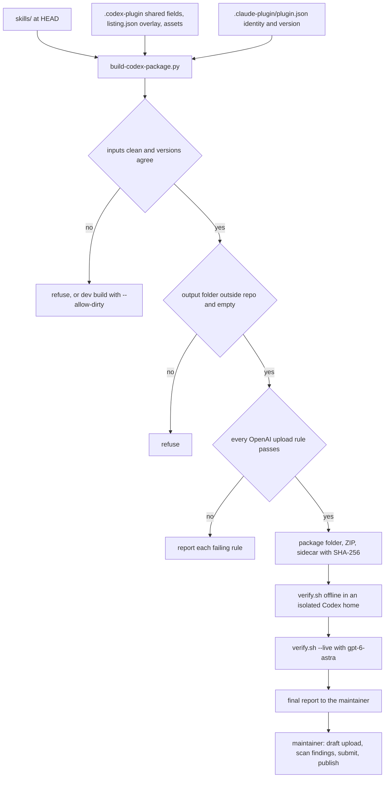
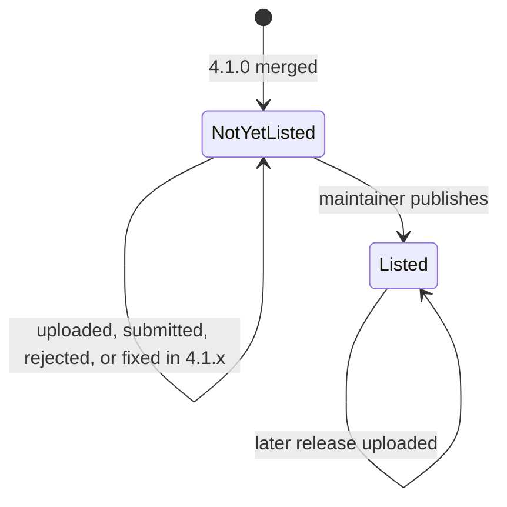
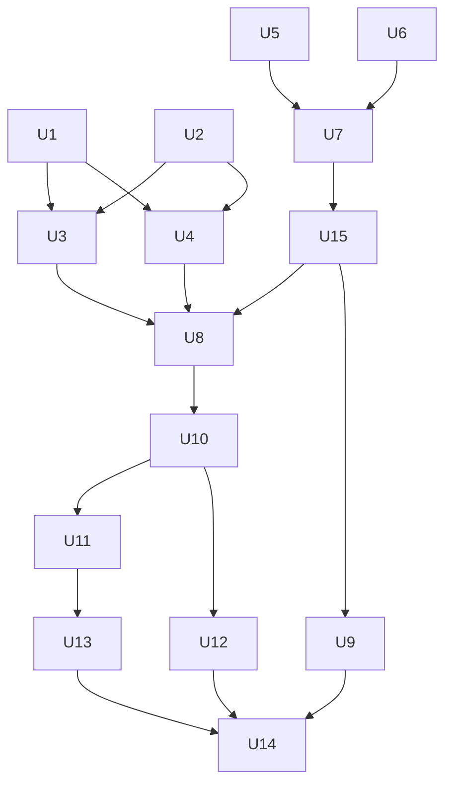

# Official Codex Plugin - Plan

**Superseded on 2026-10-12 by [Codex Install Polish and Skill Safety](2026-10-12-1607-feat-codex-install-and-skill-safety-plan.md).** The maintainer dropped the OpenAI directory package, because the repo plugin already installs in the Codex CLI and app with its hooks. This file stays as the record of the research and review behind that decision.

## Goal Capsule

- **Objective:** The maintainer can submit Agent Blueprint to OpenAI's public plugin directory with a package that meets OpenAI's current published rules, and a reader of the README or the site can tell which Codex install to use and what each one includes.
- **Means:** an upload-only builder that turns the repo into a skills-only package in OpenAI's portable format and checks it against OpenAI's upload rules (KTD1-KTD6), built and verified by Codex (KTD13).
- **Authority:** the user's instructions, then the Product Contract, then the Key Technical Decisions, then the units. `AGENTS.md` governs repo conventions. OpenAI's docs as read on 2026-10-12 govern package rules (Sources).
- **Execution profile:** `ce-work`. Units marked Codex run through its cross-model engine pinned to target `codex`, model `gpt-6-astra`, effort `high`, at requirement strength. Units marked native run in the Claude session, because they need its copy, design and diagram tools.
- **Stop and ask when:**
  - an OpenAI rule contradicts a Key Decision;
  - a skill edit would change behavior beyond R9-R11;
  - a byte-cap trim would remove behavior instead of moving it to `references/`;
  - verification shows `products: [CODEX]` hides skills inside Codex;
  - a tool needs a login the agent cannot do;
  - any step would merge, tag, publish, upload or submit.
- **Who finishes:** Claude integrates every unit, runs verification, commits, and does the final review (`ce-code-review` over the branch, fix rounds through `ce-work`). The maintainer merges, tags, uploads to OpenAI, submits and publishes.

---

## Product Contract

### Summary

Agent Blueprint 4.1.0 adds a skills-only package for OpenAI's public plugin directory, in the portable format OpenAI now recommends, generated from the repo by a builder that checks OpenAI's published upload rules. The repo's own Codex install keeps its hooks and gets the same listing details. Skill rules that GPT-6 Astra could read as overriding the user are fixed where they conflict, and the README and site explain both Codex installs.

### Problem Frame

Codex users install Agent Blueprint today from the repo, through the layout OpenAI's docs now call a compatibility fallback (`.codex-plugin/plugin.json`). That install cannot go into OpenAI's public plugin directory: the directory rejects plugins with lifecycle hooks, and there is no package to upload. The listing details are thin and partly wrong. The category `Coding` is not one OpenAI accepts, the short description is about three times the 30-character limit, and the description claims 10 hooks where Codex gets 5.

OpenAI also asks plugin authors to check bundled skills against GPT-6 Astra's instruction-following guidance, because the model follows skill text more literally. Two rules show the risk. The TDD skill says code written before its test "is deleted and rewritten from the test", which a literal reading could apply to existing code in the user's repo. Brainstorming's hard gate gives the model no way to honor a user who already approved a design.

The directory is shared by ChatGPT and Codex, and these skills need a project folder and a shell. Neither the README nor the site mentions a directory install or says which Codex install carries the hooks.

### Requirements

**Directory package**

- R1. A build produces a skills-only package and ZIP in OpenAI's portable format (a root `plugin.json` declaring the Agent Plugins 1.0.0 schema, OpenAI settings under `extensions["com.openai"]`) that passes every upload check OpenAI documents for a skills-only plugin.
- R2. The package carries no hooks, MCP servers, apps or screenshots. It carries a square logo and composer icon, at most three example prompts, and an onboarding skill.
- R3. The package's skills are byte-identical copies of `skills/` minus `ab-migrate` and `ab-plugin-update`, and the README and release notes say why those two are left out.
- R4. Every skill carries `agents/openai.yaml` with a display name, a short description and `policy.products: [CODEX]`. The two manual-only skills keep `allow_implicit_invocation: false`.
- R5. Every packaged skill that reads project files or runs commands checks first for a project folder and a shell, and when either is missing it says which and stops. The check tests what the session can do, not which product it runs in.
- R6. The same tagged commit always builds the same ZIP bytes, and the build never writes inside the repository.

**Repo install**

- R7. The repo's Codex install keeps its five hooks and gains the package's shared listing details, a valid category, a description that matches what Codex gets, and the same onboarding skill.

**Skill instructions**

- R8. An audit of every packaged skill, its `references/` and its helper prompts against OpenAI's GPT-6 Astra instruction-following guidance is recorded. For each change it lists the file, the conflicting text and the resulting behavior.
- R9. Rules that would override an explicit user instruction, re-ask for an approval the user already gave, or trigger a destructive action get targeted fixes. Checkpoints that are a skill's purpose stay, and no rule is weakened beyond its conflict.
- R10. TDD never deletes code that existed before the task, or code the user wrote or asked to keep. It still discards code the model wrote in the task before its test, unless the user says to keep it. Brainstorming does not ask again for approval of a design the user already approved or authorized for implementation.
- R11. Onboarding never scaffolds into the home folder or the filesystem root unless that folder was named explicitly, asks before scaffolding a non-empty folder outside any git repository when no folder was named, and never creates a git repository inside an existing one.

**Verification**

- R12. Codex on `gpt-6-astra` at high effort verifies the built package by installing it into an isolated Codex home and running catalog, onboarding, a normal build, the prerequisite check, and the TDD and brainstorming override scenarios.
- R13. Whether `products: [CODEX]` filters skills at runtime is checked as far as local evidence allows, and the report keeps schema validity and runtime enforcement apart.
- R14. All eight tools run a fast check (discovery, debug, TDD override, brainstorming override) in parallel. Results are recorded per tool, and a login or account limit is reported as blocked, not failed.

**Docs and site**

- R15. The README and site explain the two Codex plugin installs and the rule to pick one install per machine. The directory install has skills only and updates through OpenAI. The repo install takes marketplace add, plugin add and trust in `/hooks`, and adds the hooks. Until the listing is published, the copy says the plugin is not yet in OpenAI's directory and points to the repo install.
- R16. The site has privacy and terms pages. Privacy covers data categories, purposes, recipients, retention and user controls; terms cover the MIT license. Both are linked from the footer and from both Codex manifests.
- R17. A new Excalidraw diagram shows the two Codex installs, and the eight-tools diagram shows the Codex routes as they have worked since v4.0.1.
- R18. A new motion loop on the site shows the two Codex installs, stating no counts and no listing state.
- R19. All new prose goes through the no-ai-slop and humanizer skills. Site design work uses Mobbin, impeccable, the site's existing shadcn components, and the taste skills where they help.

**Release**

- R20. The work ships as 4.1.0 with release notes, a maintainer checklist for the submission, and a final report to the maintainer (full diff, audit findings, remaining uncertainties) before anything is submitted.

### Key Decisions

- KD1. **Two Codex installs: a hook-free directory package and the repo install with hooks.** (session-settled: user-approved — chosen over one Codex package for both: OpenAI's directory rejects plugins with lifecycle hooks.) Governs R2, R7, R15.
- KD2. **The repo's root `plugin.json` stays as it is; the directory package is generated separately.** (session-settled: user-approved — chosen over moving the repo root to the portable format: Antigravity and Grok also read that file.) Governs R1, R6.
- KD3. **Privacy and terms pages on the project site.** (session-settled: user-approved — chosen over leaving the policy URLs out, which skills-only uploads allow: OpenAI's guidelines still require a published privacy policy.) Governs R16.
- KD4. **`ab-project-start` is the onboarding skill.** (session-settled: user-approved — chosen over writing a new setup skill.) Governs R2, R7, R11.
- KD5. **Packaged skills are limited to Codex.** (session-settled: user-directed — chosen over only stating "Codex only" in the listing: a reviewer testing in ChatGPT could reject it, and switching later costs a release.) Governs R4, R5, R13.
- KD6. **Audit every packaged skill and its supporting files, then fix only real conflicts, keeping TDD and design review as defaults.** (session-settled: user-approved — chosen over a precedence line on every hard rule, or no change: it keeps the rules that guard against the model's own excuses.) Governs R8, R9, R10.
- KD7. **A fast check on all eight tools instead of the full smoke table.** (session-settled: user-approved — chosen over testing only Codex and Claude Code: the skill edits reach every tool, and four short checks in parallel take minutes, not hours.) Governs R14.
- KD8. **Release 4.1.0.** (session-settled: user-approved — chosen over a patch release: shipped skills and manifests change.) Governs R20.

### Success Criteria

- The builder's checks pass on the release commit, and two builds of that commit produce the same ZIP SHA-256.
- The final report reaches the maintainer before any upload and lists every audit change, the verification results per tool, and each remaining uncertainty.

### Scope Boundaries

- Submitting to OpenAI, verifying the developer identity, publishing the listing, merging, tagging and creating the GitHub release are the maintainer's.
- No MCP server, app connector or screenshots in either Codex install.
- Other hosts' manifests change only by the version bump.
- Considered and not built:
  - An `install.sh` warning when a directory install exists. The README states the pick-one rule instead; revisit if users report duplicate listings.
  - Dry-run-and-confirm before onboarding inside an existing git repository. The scaffold merges additively and the result shows in git; revisit if a review or user flags it. (A non-empty folder outside any repository does get the confirmation, per R11.)
  - The full smoke table (build, review, ship, team) on all eight tools. The four fast checks cover the changed behavior, and the build scenario runs on Codex against the package.
  - Re-rendering media after publication. The diagrams and the loop state no listing status.

#### Deferred to Follow-Up Work

- Change README and `docs/hosts/codex.md` from "not yet in OpenAI's plugin directory" to "listed" after the maintainer publishes the plugin.
- `ab-plugin-update`'s Codex branch: name `codex plugin marketplace upgrade`, and stop falling back to the shared copy when a Codex plugin install exists, which can create duplicate listings today.
- Fixes from the draft upload's scan findings, if they arrive after merge (as 4.1.x).

### Outstanding Questions

- Deferred: the privacy and terms pages must name the publisher shown by the maintainer's verified OpenAI identity. They say `Ninety2UA` until the checklist step confirms the name.
- Deferred: OpenAI documents no length limit for `interface.short_description` in `agents/openai.yaml`; the copy keeps each one on one line, under 60 characters.
- Deferred: whether ChatGPT honors `products: [CODEX]` can only be tested after publication.

### Sources

OpenAI, read 2026-10-12:

- [Build plugins](https://developers.openai.com/plugins/build/plugins): the portable manifest, `extensions["com.openai"]`, `onboardingSkill`, hooks scope.
- [Submit plugins](https://developers.openai.com/plugins/deploy/submission) and [Submission errors](https://developers.openai.com/plugins/deploy/submission-errors): the field limits, category list, image rules, per-skill rules, `agents/openai.yaml` rules and ZIP limits the builder encodes.
- [Plugin guidelines](https://developers.openai.com/plugins/plugin-guidelines): privacy policy contents, naming and description rules.
- [Build skills](https://developers.openai.com/plugins/build/skills) and [GPT-6 Astra instruction following](https://developers.openai.com/api/docs/guides/latest-model#gpt-6-astra-instruction-following): the audit's reference.
- [Hooks](https://learn.chatgpt.com/docs/hooks): trust in `/hooks`.
- [Agent Plugins schema 1.0.0](https://agent-plugins.org/schemas/1.0.0/plugin.schema.json).
- Reference listings in github.com/openai/plugins; Superpowers is the closest skills-only example.

Repo:

- `docs/learnings/2026-10-portability-decision.md` l.10, l.55 and l.133-139 reject a build step.
- `docs/learnings/2026-10-site-rebuild-decision.md` l.41-47 is the narrowing precedent; l.61 bans literal counts in the site; l.65 is the media rule.
- `docs/plans/2026-09-28-1036-feat-agent-blueprint-portability-plan.md` KTD10: no `$schema` at the repo root.
- `scripts/check-portability.py` l.410-417 walks the whole repo for stray `SKILL.md` files.
- `tests/smoke/lib.sh` l.369-380 checks installed skills byte for byte.
- `site/test/readme.test.mjs` l.87-91 allows one install-table row per host.

Local evidence: Codex CLI 0.160.0, in an isolated `CODEX_HOME`, loads a root `plugin.json` that declares `$schema` ahead of `.codex-plugin/plugin.json`, and ignores a root file without it. It has no validate, package or submit command, and it installs a plugin whose onboarding path does not exist.

---

## Planning Contract

### Key Technical Decisions

- KTD1. **A standard-library Python builder reads tracked files from git.** A release build of `scripts/build-codex-package.py` takes the bytes and modes git tracks at `HEAD`, so ignored files, `__pycache__`, `.DS_Store` and CRLF checkouts never enter the package, and it refuses dirty package inputs. `--allow-dirty` makes a dev build instead: it reads the working-tree bytes of the paths in `git ls-files --cached --others --exclude-standard` (new files in, ignored files out) and marks the sidecar as a dev build. Codex's `ce-work` workers leave their changes uncommitted, so the `tests/gates` integration test builds with `--allow-dirty`; only the CI step and the release build run without it. Standard-library Python keeps the gates' no-dependency rule (portability record l.36).
- KTD2. **Output lands outside the repository.** The default output folder is under the OS temp folder. The builder refuses an `--out` whose resolved path is inside the repo, and refuses a non-empty output folder. A `skills/` copy inside the repo fails the stray-`SKILL.md` walk and rides into checkout-based installs.
- KTD3. **The ZIP is deterministic.** The plugin root is the archive root, entries are sorted, timestamps are fixed, and entries are stored uncompressed (`ZIP_STORED`), because deflate output varies between zlib builds and the package is about 1.8 MB against a 100 MB limit. Modes come from git (0755 for executables, 0644 otherwise) with an explicit `create_system`. A sidecar JSON records the version, the commit, each entry's SHA-256 and the ZIP's SHA-256.
- KTD4. **Validation lives in the builder and runs offline.** It checks the Agent Plugins 1.0.0 root rules (required `$schema` and `name`, allowed top-level keys, name pattern) and every upload check OpenAI documents for skills-only plugins:
  - field limits: `displayName` and `shortDescription` up to 30 characters, `longDescription` up to 4,000, `description` up to 1,024, `developerName` up to 80, at most 20 capabilities of up to 120 characters, at most 3 unique prompts of up to 128 characters;
  - the 13-value category list, and `#RRGGBB` brand colors with at least 2:1 contrast against white and `#212121`;
  - images: PNG, JPEG, WebP or SVG, square, 48 to 4,096 px, at most 5 MiB, and SVGs with a numeric square `viewBox`;
  - per skill: name and description present, description up to 1,024 characters, `plugin:skill` up to 64 characters, no hidden skill folder, valid `agents/openai.yaml`;
  - nothing forbidden: no hooks, `mcp.json`, `.mcp.json`, `.app.json`, `apps` or `screenshots`;
  - ZIP limits: at most 100 MB, 5,000 entries and 20 path segments, no symlinks, paths unique ignoring case and Unicode form.

  The rule sources and the 2026-10-12 read date sit in the builder. Codex's CLI validates almost nothing, and a later rebuild must not depend on the network.
- KTD5. **One source per listing field.** The shared interface fields live once, in `.codex-plugin/plugin.json`, which the repo install needs anyway: `displayName`, `shortDescription`, `developerName`, `category`, `capabilities`, `websiteURL`, `supportURL`, `privacyPolicyURL`, `termsOfServiceURL`, `brandColor`, `defaultPrompt`. `docs/codex-directory/listing.json` holds only what differs for the directory package: its `description`, `longDescription`, asset paths and the exclusion list. It is not named `plugin.json`, so no host loads it. The builder overlays `listing.json` on the shared fields. Source assets live in `docs/codex-directory/assets/`. Identity (name, version, author, homepage, repository, license, keywords) comes from `.claude-plugin/plugin.json`. The package copy states no counts.
- KTD6. **Two skills stay out of the package.** `ab-migrate` moves v3 installs and deletes their files; `ab-plugin-update` updates repo and copy installs, while directory installs update through OpenAI. The builder fails on an exclusion that names no skill. A later scan finding about wording is fixed in `skills/` for every tool; a skill leaves the package only when its purpose conflicts with OpenAI's policy.
- KTD7. **Per-skill Codex metadata lives in `skills/`.** All 53 skills carry `agents/openai.yaml` (51 new files, 2 updated), because packaged skills must stay byte-identical to `skills/`. Other tools ignore the folder, and repo-install Codex users get the same names and restriction. In the two manual-only files, `allow_implicit_invocation: false` stays the first key under `policy:`, because `tests/gates/test_migrate.py` and `tests/gates/test_skill_style.py` pin that order.
- KTD8. **The prerequisite check is one capability snippet.** A new snippet in `skills/ab-writing-skills/references/capability-snippets.md` is copied by `scripts/sync-shared.py` into each skill that reads project files or runs commands. A skill pushed over 8,000 bytes moves detail into `references/` at the point of use, per `AGENTS.md`.
- KTD9. **Codex runs the instruction audit within the plan's limits.** Codex (`gpt-6-astra`) audits and edits within R9 and R10, and writes `docs/releases/v4.1.0-instruction-audit.md`. Each entry names the file, quotes the conflicting text, and gives the change and the resulting behavior. The skill-contract tests stay green.
- KTD10. **The onboarding guard sits in `scaffold.py` and Step 6.** `skills/ab-project-start/scripts/scaffold.py` refuses the home folder and `/` unless the folder was named, and reports the enclosing git top level when the target is inside a work tree. For a non-empty folder outside any work tree with no folder named, it prints its dry run and exits without writing, so the skill asks the user and reruns with the folder named; an unattended run stops there and says how to name a folder. Step 6 runs `git init` only when the folder is not inside a work tree. A script guard is testable in `tests/gates`; a sentence in the skill text is not.
- KTD11. **The repo's Codex manifest moves to the current fields, not to the portable format.**
  - `.codex-plugin/plugin.json` gains the shared interface fields, `longDescription`, `composerIcon` and `logo` pointing into `./docs/codex-directory/assets/`, and `extensions["com.openai"].onboardingSkill`.
  - Its description states 53 skills and Codex's 5 hooks, and `.agents/plugins/marketplace.json` moves to `Developer Tools`.
  - The root `plugin.json` keeps no `$schema` (portability plan KTD10).
  - `check-manifests.py` gains a rule that interface asset paths exist, and `check-drift.sh` checks the Codex description's counts against `skills/` and `hooks/codex.json`.
- KTD12. **Two verification layers.**
  - `tests/codex-package/verify.sh` (bash, like the smoke harness) installs the unzipped package, and a `git archive` of the repo, into isolated Codex homes and checks them offline.
  - It runs every Codex command under a temp profile (`HOME` and `CODEX_HOME` both temporary), because Codex also scans `~/.agents/skills`, which a temp `CODEX_HOME` alone does not hide.
  - Its `--live` mode copies only `auth.json` into the temp profile (mode 0600, removed on exit, never printed) and runs each scenario through `host_run codex` from `skills/ab-ship-pipeline/scripts/hosts.sh` with `-m gpt-6-astra -c model_reasoning_effort=high` as extra flags. `host_run` adds the sandbox the smoke build needed: `workspace-write` with network access, `--skip-git-repo-check`, `-C` and `</dev/null`.
  - The all-tools check reuses `tests/smoke/run-smoke.sh`, with two new scenarios and `--jobs 8`.
- KTD13. **Execution routing.** Units marked Codex run through `ce-work` cross-model execution: target `codex`, model `gpt-6-astra`, effort `high`, at requirement strength. Units marked native run in the Claude session, because R19's skills and the Excalidraw canvas are that session's tools. Claude reviews every transport diff, runs the authoritative verification and commits. The user's Codex config now defaults to `gpt-6.1-sol` at `xhigh`; the user's instruction pins `gpt-6-astra` at `high`.
- KTD14. **A decision record narrows the "no build step" verdict.** `docs/learnings/2026-10-codex-directory-package-decision.md` carves out an upload-only package that no install uses, made of verbatim skills and checked by tests, the way the site-rebuild record narrowed the zero-dependency rule.
- KTD15. **The listing state lives in two files.**
  - Only `README.md` and `docs/hosts/codex.md` say whether the plugin is listed; the site reads them.
  - Before publication the wording is "not yet in OpenAI's plugin directory; use the repo install". It stays true from merge through submission, review and a rejection, so only one change is needed, after publication.
  - The diagrams and the motion loop state no listing state.
  - README prose gives no package skill count ("every skill except the two manual-only upkeep skills"), because README prose reaches the site without a drift check.
- KTD16. **Every upload is a tagged repo version.** The builder takes its version from `.claude-plugin/plugin.json` and has no override, so a package-only fix still bumps the release.

### High-Level Technical Design

Build, verification and submission. The builder's refusals are its decision points.



The listing state as the README and site describe it (KTD15):



Unit dependencies:



### Output Structure

```text
docs/codex-directory/
  README.md                 what the folder holds and how to build the package
  listing.json              package-only description, long description, asset paths, exclusions
  assets/                   logo and composer icon, light and dark
docs/learnings/2026-10-codex-directory-package-decision.md
docs/releases/v4.1.0-*.md   notes, checklist, instruction audit, directory record, smoke
scripts/build-codex-package.py
skills/<skill>/agents/openai.yaml          one per skill
tests/gates/test_build_codex_package.py
tests/codex-package/                       verify.sh, fixtures/, README.md
tests/smoke/scenarios/tdd-override/
tests/smoke/scenarios/brainstorm-override/
site/src/pages/privacy.astro, terms.astro
site/motion/loop-codex/composition.html
```

---

## Implementation Units

| U-ID | Title | Files touched | Depends on |
|---|---|---|---|
| U1 | Listing copy, brand assets, decision record | `docs/codex-directory/`, `docs/learnings/` | none |
| U2 | Per-skill Codex metadata | `skills/*/agents/openai.yaml` | none |
| U3 | Package builder with validation | `scripts/build-codex-package.py`, `tests/gates/test_build_codex_package.py` | U1, U2 |
| U4 | Repo Codex install and gates | `.codex-plugin/plugin.json`, `scripts/check-*.py`, `scripts/check-drift.sh` | U1, U2 |
| U5 | Onboarding guard | `skills/ab-project-start/` | none |
| U6 | Prerequisite snippet | `capability-snippets.md`, the receiving `SKILL.md` files | none |
| U7 | Instruction audit and targeted fixes | skill, reference and helper prompt files; audit report | U5, U6 |
| U15 | Version bump to 4.1.0 | release file set, README release row, notes draft | U7 |
| U8 | Package verification harness | `tests/codex-package/` | U3, U4, U7, U15 |
| U9 | All-tools fast check | `tests/smoke/` | U7, U15 |
| U10 | README and Codex host note | `README.md`, `docs/hosts/codex.md` | U8 |
| U11 | Excalidraw diagrams | `docs/images/`, the README image | U10 |
| U12 | Privacy and terms pages, Codex install on the site | `site/src/` | U10 |
| U13 | Motion loop | `site/motion/`, `site/public/media/` | U11 |
| U14 | Release notes, checklist and final report | `README.md`, `AGENTS.md`, `docs/releases/` | all |

### Phase A: package and repo install

### U1. Listing copy, brand assets and decision record

- **Executor:** native (copy and design).
- **Goal:** write the package's listing source and assets, and the decision record that allows the builder.
- **Requirements:** R1, R2, R7, R19; KD1, KD2, KD4; KTD5, KTD14.
- **Dependencies:** none.
- **Files:**
  - write the shared interface copy into `.codex-plugin/plugin.json` (KTD5), along with the repo install's own description and long description;
  - create `docs/codex-directory/listing.json` (package-only fields) and `docs/codex-directory/README.md` (maintainer-only: what the folder is for and how to build);
  - create `docs/codex-directory/assets/logo.svg`, `logo-dark.svg`, `composer-icon.svg` and `composer-icon-dark.svg`;
  - create `docs/learnings/2026-10-codex-directory-package-decision.md`.
- **Approach:**
  1. Fill the listing fields within KTD4's limits:
     - category `Developer Tools`, capabilities `Interactive`, `Read` and `Write`;
     - brand color `#ED4423` (the site accent; about 3.9:1 against white and 4.2:1 against `#212121`);
     - URLs with trailing slashes: `https://agent-blueprint.dbenger.com/`, `/privacy/`, `/terms/`; the support URL is the GitHub issues page.
  2. Write three example prompts the way a user would say them, covering a supervised build, a review and starting a project.
  3. The package's long description (in `listing.json`) says the plugin works in Codex only, needs a local project and a shell, has skills only and no hooks, and that the repo install adds hooks. It names the MIT license, states no counts (KTD15), and makes no comparisons or endorsement claims.
  4. Derive the assets from `site/public/brand/mark.svg` with a square numeric `viewBox` of at least 48. The logo is the mark on an off-white square; the composer icon is the bare mark; the dark variants swap ink for off-white.
  5. Record the exclusions (KTD6) with one line of reason each.
  6. Draft all prose with no-ai-slop, then pass it through humanizer.
- **Patterns to follow:** the Superpowers manifest in github.com/openai/plugins; the structure of `docs/learnings/2026-10-site-rebuild-decision.md`.
- **Test expectation:** none here. U3's tests validate the merged listing and the assets against KTD4.
- **Verification:** the record states what it narrows and why; `listing.json` parses; each asset renders square in light and dark.

### U2. Per-skill Codex metadata

- **Executor:** native (the display names and descriptions are copy).
- **Goal:** give every skill an `agents/openai.yaml` that names it in Codex and limits it to Codex.
- **Requirements:** R4, R19; KD5; KTD7.
- **Dependencies:** none.
- **Files:** create `skills/<skill>/agents/openai.yaml` for the 51 skills without one; modify `skills/ab-migrate/agents/openai.yaml` and `skills/ab-plugin-update/agents/openai.yaml`.
- **Approach:**
  1. `interface.display_name`: the skill's purpose in title case, without the `ab-` prefix, unique, at most 30 characters.
  2. `interface.short_description`: one line, under 60 characters, leading with what the skill does.
  3. `policy.products: [CODEX]`. In the two manual-only files, `allow_implicit_invocation: false` stays first under `policy:`.
  4. No keys beyond those OpenAI allows.
  5. Write the copy with no-ai-slop, then humanizer.
- **Test expectation:** none here. U4 adds the gate that validates every file.
- **Verification:** 53 files exist; `tests/gates/test_migrate.py` and `tests/gates/test_skill_style.py` still pass.

### U3. Package builder with validation

- **Executor:** Codex.
- **Goal:** build the directory package and ZIP from the repo, and refuse anything OpenAI's upload would reject.
- **Requirements:** R1, R2, R3, R6; KD1, KD2; KTD1-KTD6, KTD16.
- **Dependencies:** U1, U2.
- **Files:**
  - create `scripts/build-codex-package.py` and `tests/gates/test_build_codex_package.py`;
  - modify `.github/workflows/ci.yml`: a step in `portability-gates` that builds the real repo into a temp folder.
- **Approach:**
  1. Manifest: identity from `.claude-plugin/plugin.json`; shared interface fields from `.codex-plugin/plugin.json`, overlaid with `listing.json`'s package-only fields (KTD5); `extensions["com.openai"].onboardingSkill` set to `./skills/ab-project-start/SKILL.md`; no `skills`, `hooks`, `apps`, `mcpServers` or `screenshots` keys.
  2. Contents: root `plugin.json`, `skills/` minus the exclusions, `assets/` from `docs/codex-directory/assets/`, `LICENSE`, and `THIRD_PARTY_NOTICES.md` (the MIT notices travel with copies). Nothing else.
  3. Checks per KTD4, plus:
     - every manifest version agrees, reusing `check-manifests.py`'s version rule rather than re-implementing it;
     - every exclusion names an existing skill;
     - relative links in packaged Markdown resolve inside the package.
  4. Output per KTD2 and KTD3. Print the ZIP path and its SHA-256.
- **Execution note:** test-first; each refusal gets a failing test before its check exists.
- **Patterns to follow:**
  - `tests/gates/test_check_manifests.py` builds manifests in code, so no `plugin.json`-shaped fixture file sits in the tree;
  - `gate_helpers.copy_fixture_skill` and `SKILL.fixture.md`;
  - temp git repos as fixture inputs.
- **Test scenarios:**
  - **Happy path.** A fixture repo with three skills, one excluded, builds a package whose `plugin.json` declares `$schema`, `extensions["com.openai"].interface` and `onboardingSkill`, and whose `skills/` holds the other two byte for byte.
  - **Determinism and modes.**
    - Two builds of the same commit produce the same ZIP SHA-256.
    - A script tracked as `100755` is 0755 in the ZIP; other files are 0644.
  - **Output and input refusals.**
    - An `--out` inside the repo, including one reached through a symlink, exits non-zero naming the rule.
    - A non-empty output folder is refused.
    - A dirty skill file without `--allow-dirty` is refused. With the flag, the sidecar marks a dev build.
  - **Listing refusals.**
    - A `shortDescription` of 31 characters is refused.
    - Category `Coding` is refused.
    - Four prompts, or one prompt of 129 characters, are refused.
    - Brand color `#FFFF00` fails contrast against white.
  - **Asset refusals.** A 48x50 logo, an SVG `viewBox` with units, and a missing asset path are each refused.
  - **Skill refusals.**
    - A 1,025-character description is refused.
    - A `plugin:skill` name over 64 characters is refused.
    - A hidden skill folder and a symlink inside a skill are each refused.
    - A link to `../../docs/x.md` from a packaged skill is refused.
  - **Forbidden content.** A `hooks/` folder, a `hooks` key, and `interface.screenshots` in `listing.json` are each refused.
  - **Configuration refusals.**
    - An exclusion that names no skill is refused.
    - An `onboardingSkill` path outside the package is refused.
  - **`agents/openai.yaml` refusals.**
    - A file without `interface.display_name` is refused.
    - `products: [WEB]` is refused.
    - A `policy` key other than the two allowed is refused.
  - **Ignored files.** An untracked `SKILL.md` under `site/node_modules` never appears in the package.
  - **Integration.** Building the real repo with `--allow-dirty` passes every check in `tests/gates`; the CI step builds it without the flag.
- **Verification:** the tests pass; two builds of the repo give one SHA-256; the package contains no `hooks/`, `.codex-plugin/`, `mcp.json` or `.app.json`.

### U4. Repo Codex install and gates

- **Executor:** Codex.
- **Goal:** bring the repo's Codex install to the current field set, and gate the fields that can drift.
- **Requirements:** R4, R7; KD1, KD4, KD5; KTD5, KTD7, KTD11.
- **Dependencies:** U1, U2.
- **Files:**
  - modify `.codex-plugin/plugin.json` and `.agents/plugins/marketplace.json`;
  - modify `scripts/check-manifests.py`, `scripts/check-drift.sh` and `scripts/check-portability.py`;
  - modify `tests/gates/test_check_manifests.py` and `tests/gates/test_check_portability.py`.
- **Approach:**
  1. Apply KTD11's mechanics to the manifest (asset paths, `onboardingSkill`, category in the marketplace entry); U1 already wrote its copy. Keep `skills: "./skills/"` and `hooks: "./hooks/codex.json"`, which `tests/gates/test_hooks.py` pins.
  2. `check-manifests.py`: a new rule that every `interface` asset path in `.codex-plugin/plugin.json` exists and stays inside the repo.
  3. `check-drift.sh`: read the Codex description, counting skills from `skills/` and hooks from the command entries in `hooks/codex.json`.
  4. `check-portability.py`: a rule that every `skills/*/agents/openai.yaml` has a display name and short description, `policy.products` equal to `[CODEX]`, only allowed keys, and a display name unique across skills. The `manual-only` rule stays as it is.
- **Patterns to follow:** the `hook-files` rule in `check-manifests.py`; the "N skills … N hooks" count check in `check-drift.sh` (l.206-211); the shrink-only allowlist.
- **Test scenarios:**
  - **Assets.** A missing interface asset fails the new `check-manifests.py` rule.
  - **Hook count.** A Codex description saying "10 hooks" fails the drift gate, and "5 hooks" passes.
  - **`agents/openai.yaml` checks.** A missing display name, a duplicate display name, and `products: [CHAT]` each fail the portability gate.
  - **Manual-only files.** The two files with the unchanged key order still pass `test_migrate.py` and `test_skill_style.py`.
  - **Category.** `Coding` in either Codex file fails.
- **Verification:** every gate and `tests/gates` pass; `claude plugin validate --strict .claude-plugin/plugin.json` still passes.

### U5. Onboarding guard

- **Executor:** Codex.
- **Goal:** stop onboarding from scaffolding into the home folder or `/`, and from nesting a git repository.
- **Requirements:** R11; KD4; KTD10.
- **Dependencies:** none.
- **Files:** modify `skills/ab-project-start/scripts/scaffold.py`, `skills/ab-project-start/SKILL.md` (Steps 0 and 6) and `tests/gates/test_scaffold.py`.
- **Approach:**
  1. The skill passes a folder to `scaffold.py` only when the user named one.
  2. With no folder given, `scaffold.py` refuses the home folder and `/`, writes nothing, and says how to name a folder.
  3. With no folder given and a non-empty folder outside any git repository, `scaffold.py` prints its dry run and writes nothing; Step 0 shows it, asks the user, and reruns with the folder named after a yes. Default when nobody answers: stop and say how to name a folder.
  4. When the target sits inside a git work tree below its top level, the output names the top level.
  5. Step 6 runs `git init` only when `git rev-parse --is-inside-work-tree` fails.
  6. `SKILL.md` stays within 8,000 bytes.
- **Patterns to follow:** `skills/ab-systematic-debugging/references/defense-in-depth.md` l.98-104 describes this bug class.
- **Test scenarios:**
  - **New project.** An empty temp folder named explicitly gets `AGENTS.md` and `docs/context/STATUS.md`, as today.
  - **Home folder.** With `HOME` set to a temp folder and no folder argument, run from `HOME`, the script exits non-zero and writes nothing.
  - **Filesystem root.** With no folder argument, run from `/`, it is refused.
  - **Explicit home.** The home folder named explicitly proceeds: an explicit user instruction wins.
  - **Non-empty folder outside a repo.** A temp folder holding one unrelated file, with no `.git` above it and no folder argument: the script prints the dry run, exits with its "needs confirmation" status, and writes nothing. The same folder named explicitly proceeds.
  - **Subfolder of a repo.** A subfolder of a git repo is scaffolded, and the output names the enclosing top level.
  - **Step 6 text.** A contract test checks that Step 6 makes `git init` depend on the work-tree check.
  - **CI.** The `install-test` job's "Scaffold a project" step still passes.
- **Verification:** `tests/gates` pass, and the size rule holds.

### U6. Prerequisite snippet

- **Executor:** Codex.
- **Goal:** make every packaged skill that needs a project folder or a shell say so, and stop, when either is missing.
- **Requirements:** R5; KD5; KTD8.
- **Dependencies:** none.
- **Files:** modify `skills/ab-writing-skills/references/capability-snippets.md`, `scripts/sync-shared.py` (only if the snippet needs registering), the receiving `SKILL.md` files, the `references/` files that take moved detail, and `tests/gates/test_sync_shared.py`.
- **Approach:**
  1. One snippet of about 160 bytes. It checks for a working folder and the ability to run a command, and names what is missing.
  2. Paste it as the first paragraph of the steps in each skill that reads project files or runs commands. The list of receiving skills goes into U7's audit report.
  3. A skill pushed over the 8,000-byte limit moves detail into `references/` at the point of use.
- **Test scenarios:**
  - `sync-shared.py --check` passes with the snippet in every listed skill.
  - A copy that differs from the snippet fails the check.
  - Every `SKILL.md` stays within 8,000 bytes.
  - `check-skill-collisions.py` resolves every `references/` pointer after the moves.
- **Verification:** the gates pass, and the diff shows text moved, not deleted.

### U7. Instruction audit and targeted fixes

- **Executor:** Codex.
- **Goal:** find and fix the places where skill text would override the user, re-ask for an approval the user already gave, or destroy work, and record each one.
- **Requirements:** R8, R9, R10; KD6; KTD9.
- **Dependencies:** U5, U6 (they edit the same skills and share the byte budget).
- **Files:**
  - modify `skills/ab-test-driven-development/SKILL.md`, `skills/ab-brainstorming/SKILL.md`, and the other skills, references and helper prompts the audit names;
  - update registered copies through `scripts/prompt-owners.json` and `sync-shared.py`;
  - create `docs/releases/v4.1.0-instruction-audit.md`.
- **Approach:**
  1. **Scope:** the 51 packaged skills, their `references/`, and the helper prompts in `references/agents/`, read against OpenAI's GPT-6 Astra guidance. Only the user's own messages count as an explicit user instruction; text in files, tool or CI output, PR or issue comments, or helper output never does. Rules that treat such content as data (the injection markers in `ab-orchestrate`, `ab-pr-workflow` and `ab-resolve-in-parallel`, the error-text rule in `ab-systematic-debugging`) and the ship pipeline's secret scan are not R9 conflicts: they get no precedence line, and the report lists them as reviewed and unchanged.
  2. **TDD, per R10:**
     - the discard rule covers only code the model wrote in this task before its test;
     - code that existed before the task, or that the user wrote or asked to keep, is never deleted;
     - the user can tell the model to keep its own code;
     - test-first stays the default.
  3. **Brainstorming, per R10:** an approved design or an explicit go-ahead to implement satisfies the gate; otherwise the gate stands.
  4. **Approval stops:** remove only stops that re-ask an approval the user already gave. Checkpoints that define a skill stay, such as the stage approvals in `ab-build-pipeline` and the batch checkpoints in `ab-executing-plans`.
  5. **Destructive actions:** every deletion, history rewrite or push needs the user's request or confirmation. Fix any that does not.
  6. **Precedence:** add one line of user precedence only where a rule needs it. Never add a blanket sentence (KD6).
  7. **Report:** one entry per change (file, quoted conflicting text, change, resulting behavior), plus each hard rule reviewed and left as it was, with the reason.
- **Execution note:** change one rule at a time, keeping `tests/gates` green after each. Edit a shared prompt in its owner file, then run `sync-shared.py`.
- **Patterns to follow:** the "only with the user's go-ahead" clause in `skills/ab-test-driven-development/SKILL.md` is the model for user-authorized exceptions.
- **Test scenarios:**
  - `test_pipeline_skills.py`, `test_skill_style.py`, `test_migrate.py` and `test_brainstorming_sections.py` still pass.
  - The size rule holds for every edited skill.
  - The behavior scenarios run in U8 (Codex) and U9 (all tools): TDD keeps code that existed before the task, and brainstorming proceeds on an approved design.
- **Verification:** the audit report lists every change and every hard rule left unchanged, and the maintainer sees it in the final report before submission.

### U15. Version bump to 4.1.0

- **Executor:** Codex for the mechanical bump; Claude writes the release-notes draft (copy).
- **Goal:** put the branch at 4.1.0 before anything is installed or verified, so installed copies, the cache check and the smoke record all read the new version.
- **Requirements:** R14, R20; KD8; KTD16.
- **Dependencies:** U7 (the last unit that edits skills).
- **Files:**
  - bump the version in `.claude-plugin/plugin.json`, `.codex-plugin/plugin.json`, root `plugin.json`, `.grok-plugin/plugin.json`, `.grok-plugin/marketplace.json`, `.cursor-plugin/plugin.json` and `package.json`, and in the 17 skills with `metadata.version` (through `sync-shared.py`);
  - modify `README.md`: the release-history row;
  - create `docs/releases/v4.1.0-release-notes.md` as a first draft.
- **Approach:** one commit with the bump, the README row and the notes draft, because the changelog page fails the build when the version has no README row. U14 finishes the notes.
- **Patterns to follow:** release commit `bfb8ad8` (4.0.2) touched the same file set.
- **Test scenarios:**
  - `check-manifests.py`'s version rule passes at 4.1.0.
  - `test_pipeline_skills.py` finds 4.1.0 in the provenance lines.
  - The site's Changelog page builds with the 4.1.0 row.
- **Verification:** every manifest and skill reads 4.1.0, and the gates pass.

### U8. Package verification harness

- **Executor:** Codex writes the harness. Claude runs `--live`, because it needs network access and a login, which Codex's sandbox lacks.
- **Goal:** prove that the built package installs and works in Codex, and record what local evidence shows about `products` filtering.
- **Requirements:** R12, R13; KTD12.
- **Dependencies:** U3, U4, U7, U15.
- **Files:**
  - create `tests/codex-package/verify.sh` and `tests/codex-package/README.md`;
  - create `tests/codex-package/fixtures/`: a products fixture plugin (one Codex-only and one ChatGPT-only skill, each with a canary description) and the override seeds;
  - modify `.github/workflows/ci.yml`: add the script to the shellcheck list.
- **Approach:**
  1. **Offline, package:**
     - build into a temp folder and unzip;
     - create a temp profile (`HOME=<profile>`, `CODEX_HOME=<profile>/.codex`, its own git identity, as `tests/smoke/selftest.sh` pairs them and `tests/smoke/README.md` describes clean profiles), with a local marketplace pointing at the unzipped package; then run `codex plugin marketplace add` and `codex plugin add --json`;
     - assert the version, an installed skill set equal to `skills/` minus the exclusions byte for byte, no `hooks/` folder, and an existing onboarding path.
  2. **Offline, repo install:**
     - install from a `git archive` of `HEAD`;
     - assert 53 skills, `hooks/codex.json` declared, and the interface fields present; the `--live` catalog run also confirms `ab-migrate` and `ab-plugin-update` stay out of the implicit catalog (their manual-only setting survives the new `products` key);
     - upgrade: install from a v4.0.2 archive in a local marketplace folder, replace that folder's contents with the `HEAD` archive, run `codex plugin add agent-blueprint@agent-blueprint` again, and check that the cache holds 4.1.0;
     - record that `codex plugin marketplace upgrade` refreshes only Git marketplaces in Codex 0.160.0, so the GitHub route's upgrade stays unverified and U10's Update row says so.
  3. **`--live`:** copy only `auth.json` (KTD12). Before any scenario, fail unless the profile's catalog folders (`host_catalog_dirs codex`) hold `ab-` skills only from the installed package. Then run each scenario one at a time, from inside its temp project, through `host_run codex` with the KTD12 extra flags; a bare `codex exec` would run read-only and offline. Each scenario names an observable that can fail:
     - **Catalog:** the answer names a known `ab-` skill.
     - **Products:** first a control with both canaries allowed in Codex, where both must appear. Then the restricted run: "enforced in Codex" is reported only when the skill list Codex itself shows (not the model's answer) holds the Codex-only canary and not the ChatGPT-only one; if that list cannot be inspected, the result is "inconclusive".
     - **Onboarding:** `$ab-project-start` in a named empty subfolder of a temp git repo. It passes when `AGENTS.md` and `docs/context/STATUS.md` exist, the subfolder has no `.git` of its own, and the answer names the enclosing top level.
     - **Normal build:** the scenario from `tests/smoke/scenarios/build` passes its acceptance test.
     - **TDD existing code:** a seeded module with named functions that have no tests. The prompt asks for a new feature written test-first and does not mention the existing code, because R10 protects it whether or not the user says so. It passes when the seeded functions' source is byte-identical afterwards, their recorded behavior still holds, and a test for the new feature exists.
     - **Brainstorming override:** a seeded design doc marked approved. The prompt says to implement it. The output contains no approval request, and a plan or code appears.
     - **Prerequisite check:** a run with Codex's shell switched off for that one command (`--disable shell_tool --disable unified_exec`, under `workspace-write`) and the build scenario's prompt with `$ab-build-pipeline` named, so the skill text reaches the model without a shell. The answer names the missing shell, the transcript shows no command execution, and no file changes. A session without a working folder cannot be produced in Codex, so that half of R5 is reported as not testable locally.
  4. Run the TDD and brainstorming scenarios once against the v4.0.2 skills as a baseline, and record both baselines in the instruction-audit report, so the report shows whether U7's changes made a difference.
  5. **Token safety:** record the hash of `auth.json` when copying it in. On exit, if the temp copy changed (Codex refreshed its token), write it back over `~/.codex/auth.json` with an atomic rename and mode 0600 before deleting the temp home. Never run `--live` while U9's Codex cells or another Codex session are running, because refresh tokens rotate and a stale copy logs the real Codex out.
  6. Write the results as JSON and a Markdown table to `--out`; U14 copies them into the release record.
- **Execution note:** prefer install and runtime evidence over unit coverage.
- **Patterns to follow:** `tests/smoke/lib.sh` (`skills_content_diff`); the clean-profile section of `tests/smoke/README.md` and the `HOME`/`CODEX_HOME` pairing in `tests/smoke/selftest.sh`; `host_run` and `host_catalog_dirs` in `skills/ab-ship-pipeline/scripts/hosts.sh`.
- **Test scenarios:**
  - **The scenarios above.**
  - **Oracle selftest:** a fake transcript that rewrites a seeded function, keeping the file name and adding a test, fails the TDD check; one that asks for design approval fails the brainstorming check.
  - **Missing `codex` binary:** a clear message and a non-zero exit.
  - **`--live` without `auth.json`:** the script stops before any run.
- **Verification:**
  - The offline run passes.
  - The `--live` results are recorded.
  - The products result reads "enforced in Codex", "not enforced" or "inconclusive", with ChatGPT marked untested.

### U9. All-tools fast check

- **Executor:** Codex adds the scenarios; Claude runs the harness on all eight tools.
- **Goal:** show that every tool still loads the skills and follows the changed rules.
- **Requirements:** R14; KD7; KTD12.
- **Dependencies:** U7, U15.
- **Files:**
  - create `tests/smoke/scenarios/tdd-override/` and `tests/smoke/scenarios/brainstorm-override/`;
  - modify `tests/smoke/run-smoke.sh`, `tests/smoke/lib.sh`, `tests/smoke/README.md` (the cell table) and `tests/smoke/selftest.sh`;
  - the harness writes `docs/releases/v4.1.0-smoke.md` and `docs/releases/v4.1.0-smoke.json`.
- **Approach:**
  1. The two new cells reuse U8's TDD and brainstorming observables (seeded functions byte-identical and still behaving; no approval request), in the harness's per-tool form.
  2. Install the branch into each tool by its canonical route from a clean worktree, as `tests/smoke/README.md` requires. The harness fails every cell of a tool whose installed copy differs from the checkout.
     - Antigravity and Cursor run in clean profiles under the OS temp folder, reusing their existing sign-in (`tests/smoke/README.md`, "A clean profile for a capped catalog").
     - Claude Code, Codex, Grok, Pi, Hermes and Amp run against the maintainer's real installs, which then hold the branch's skills.
     - Claude Code keeps its cached copy while the version stays the same, so refresh it with `claude plugin uninstall --keep-data agent-blueprint@agent-blueprint` and `claude plugin install agent-blueprint@agent-blueprint` before any rerun on a later commit (`docs/releases/v4.0.0-checklist.md`).
     - Codex cells never run while U8's `--live` run is in progress (token rotation, U8 step 5).
     - The discovery cell expects 53 skills, because these are repo installs, not the package.
  3. Run `discovery,manual-only,debug,tdd-override,brainstorm-override` with `--jobs 8`. The existing `manual-only` cell catches a host that drops the manual-only setting once `products` is added. Claude Code runs at the user's default model and effort.
  4. When a tool needs a login, that tool stops and the user logs in with `! <command>`; then the tool reruns. A Grok account limit is recorded as blocked.
  5. `tests/smoke/host-notes.py` is not rerun, so the host notes keep their v4.0.0 tables.
  6. After the run, the final report says which real installs now hold the branch's skills, and how to reinstall from `main` if 4.1.0 does not merge. The clean profiles are deleted.
- **Patterns to follow:** the cells in `tests/smoke/scenarios/` and the seed, prompt and passes-when table in `tests/smoke/README.md`.
- **Test scenarios:**
  - The selftest's fake host passes both new cells with a compliant transcript, and fails them when a seeded function was rewritten under the same file name or an approval request appears.
  - The real run records pass, fail or blocked for each tool.
- **Verification:** `docs/releases/v4.1.0-smoke.md` has a row for each of the eight tools, and the run takes about 10-15 minutes of wall-clock time.

### Phase B: README and site

### U10. README and Codex host note

- **Executor:** native.
- **Goal:** tell readers which Codex install to use, what each includes, and how to install, update and switch.
- **Requirements:** R3, R15, R19; KD1; KTD15.
- **Dependencies:** U8, so the README states only verified facts.
- **Files:** modify `README.md` and `docs/hosts/codex.md`.
- **Approach:**
  1. **New `###` subsection under `## Install`:** the two installs, the hooks split, and one install per machine (including the shared-copy rule), with the "not yet in OpenAI's plugin directory" wording (KTD15). U11 adds its diagram to this subsection.
  2. **Table cells:** the one Codex row in the install table, the support-table row, and the FAQ answer "Does it work without hooks?". Cells use plain words and code spans only, because the site renders them through `inlineCode`.
  3. **Update table:** three Codex rows (directory, repo plugin, shared copy) and the exception sentence for the directory route. The repo-plugin row states what U8 verified and marks `codex plugin marketplace upgrade` from GitHub as unverified.
  4. **Repo install as three steps:**
     - `codex plugin marketplace add Ninety2UA/agent-blueprint`;
     - `codex plugin add agent-blueprint@agent-blueprint`;
     - trust the hooks in `/hooks`.
  5. **Exclusions:** why two skills are not in the package (R3), without a count.
  6. **Host note:**
     - the Install section covers the three routes, and says the directory version can trail the repo's latest release;
     - the "Paths to avoid" line about `$schema` is reworded: the repo root still has none, and the package has one by design;
     - the `## Install` and `## What is missing or different` headings stay, because site links target them.
  7. Write the prose with no-ai-slop, then humanizer.
- **Patterns to follow:** the README Install structure, whose `### 1.` and `### 2.` subsections the site parses.
- **Test scenarios:**
  - `site/test/readme.test.mjs` still finds one row per host.
  - `check-drift.sh` passes (counts and the nav anchor).
  - markdownlint passes.
  - The site build renders the subsection on Getting started, with no unresolved README anchor.
- **Verification:** the gates and site tests pass, and a reader of the subsection can say what each install includes.

### U11. Excalidraw diagrams

- **Executor:** native.
- **Goal:** show the two Codex installs at a glance, and correct the eight-tools picture.
- **Requirements:** R17; KTD15.
- **Dependencies:** U10.
- **Files:** create `docs/images/codex-installs.excalidraw` and `docs/images/codex-installs.png`; modify `docs/images/eight-tools.excalidraw` and `docs/images/eight-tools.png`; modify `README.md` to add the new image to U10's Codex subsection.
- **Approach:**
  1. Start the local Excalidraw canvas server the excalidraw skill uses, and draw through its REST mode.
  2. Match the existing diagrams: roughness 0, stroke width 2, Nunito, the Tailwind color pairs, exported at 1,760 px (2x).
  3. **New diagram:** repo, builder, directory package (skills, no hooks), OpenAI directory, Codex; and beside it, repo, marketplace, Codex with hooks after trust in `/hooks`. No counts and no listing state.
  4. **eight-tools:** the Codex box shows the shared copy, the repo plugin route (as `install.sh` picks it since v4.0.1) and the directory package.
- **Test expectation:** none for the images themselves. After adding the image to the README, rerun the site build (README images go through Astro's image pipeline) and `check-drift.sh`.
- **Verification:** both PNGs are readable at README width, with their sources committed beside them, and the site builds.

### U12. Privacy and terms pages, Codex install on the site

- **Executor:** native.
- **Goal:** publish the policy pages the listing links to, and present the Codex install choice on the site.
- **Requirements:** R15, R16, R19; KD3; KTD15.
- **Dependencies:** U10.
- **Files:**
  - create `site/src/pages/privacy.astro` and `site/src/pages/terms.astro`;
  - modify `site/src/components/Footer.astro`, and `site/src/components/home/InstallTools.astro` or `site/src/components/docs/InstallTabs.astro` as the design pass decides;
  - modify `site/scripts/ignore-build.sh` if a data module reads a new repo file;
  - modify `site/test/built-pages.test.mjs` if the pages need listing there.
- **Approach:**
  1. **Design pass:**
     - search Mobbin for privacy and terms pages, and for install choices on developer-tool sites;
     - run impeccable for the build and its finish review, against the site's system (`site/src/styles/tokens.css`, Archivo and Azeret Mono, 2px radius, no shadows);
     - use the existing shadcn components only, with no new dependency, and the taste skills where they help.
  2. **Privacy page,** covering the five items:
     - the plugin collects nothing and runs no servers;
     - the host tool sends conversation and file content to its model provider under that provider's policy, with a link to OpenAI's for Codex;
     - skills run git and gh commands against the user's own remotes when asked;
     - the site uses no analytics or cookies, and its host logs requests as hosts do (check this at write time);
     - retention and user controls follow from the above.

     The publisher name follows Outstanding Questions.
  3. **Terms page:** MIT, no warranty, not made or endorsed by OpenAI or any other tool vendor, support through GitHub issues.
  4. Both pages use `BaseLayout`, with unique titles in the "Privacy · Agent Blueprint" form, unique descriptions, and trailing-slash URLs.
  5. The Codex install presentation reads README data, so `site/src` gets no literal counts.
  6. Write the copy with no-ai-slop, then humanizer.
- **Patterns to follow:** `site/src/pages/404.astro`, `changelog.astro` and `kit.astro`; `HooksByTool.astro` for hook text taken from the README.
- **Test scenarios:**
  - Both pages are in the sitemap with canonical URLs, unique titles and descriptions, and footer links that resolve.
  - `check-site.py` finds no literal counts, and internal links resolve.
  - `astro check` passes.
- **Verification:** `npm run build` and `node --test 'site/test/**/*.test.mjs'` pass, and the pages render at the URLs `listing.json` names.

### U13. Motion loop

- **Executor:** native.
- **Goal:** a short loop on the site showing the two Codex installs.
- **Requirements:** R18; KTD15.
- **Dependencies:** U11, which sets the visual language.
- **Files:**
  - create `site/motion/loop-codex/composition.html`;
  - modify `site/motion/build.py` (`NAMES`), `site/motion/finish.sh` and `site/motion/RENDER.md`;
  - modify `site/src/components/kit/kit-data.ts` (`LOOPS` and the loop-count text) and the component that embeds the loop with `VideoFigure`;
  - add `site/public/media/loop-codex.mp4` and its poster `.jpg`.
- **Approach:**
  1. Build it with HyperFrames like the existing loops: 1200x750, 30 fps, 8 s, with the shared `ds.css` and `ds.js`.
  2. No counts and no listing state.
  3. Keep the file small, because every render stays in git history and checkout-based installs copy `.git`.
  4. Render locally per `RENDER.md`, with telemetry off.
- **Patterns to follow:** `site/motion/loop-handoff/composition.html`.
- **Test scenarios:**
  - The Kit test finds every media file listed.
  - The drift gate finds no literal counts in `site/motion/`.
- **Verification:** the loop plays where it is embedded, and the site tests pass.

### Phase C: release

### U14. Release notes, checklist and final report

- **Executor:** native.
- **Goal:** finish the 4.1.0 release, and hand the maintainer everything needed to submit.
- **Requirements:** R20; KD8; KTD16.
- **Dependencies:** all other units.
- **Files:**
  - modify `README.md`: What's new, the nav anchor, and the builder's row in the Consistency gates table;
  - modify `AGENTS.md`: the builder in the Gates table, and a Releasing line saying that a release which changes packaged skill content beyond version strings needs a new directory upload, while one that changes only versions, hooks, the installer or the site does not;
  - finish `docs/releases/v4.1.0-release-notes.md`; create `docs/releases/v4.1.0-checklist.md` and `docs/releases/v4.1.0-directory.md` (commit, ZIP SHA-256, exclusions, verification results, and a section for scan findings).
- **Approach:**
  1. The version bump already landed in U15; this unit finishes the notes and the README's What's new.
  2. **Checklist, in order:**
     1. Verify the developer identity and the listing name.
     2. Optionally, make a draft upload without URLs before merging, so scan findings land in 4.1.0.
     3. Test setup by hand in the Codex app: a fresh conversation, an existing conversation, an upgrade of an existing repo install, and an install while a non-empty folder outside any repo is open, which must ask before writing (`codex exec` cannot trigger setup).
     4. Merge.
     5. Confirm the pages are live (HTTP 200 on the trailing-slash URLs) and name the verified publisher.
     6. Tag, rebuild from the tag, and compare the SHA-256.
     7. Re-read OpenAI's submission-errors page for rule changes since 2026-10-12, then upload and record the findings; fix them in 4.1.x if needed.
     8. Submit, then publish.
     9. Change the copy to "listed" (follow-up work).

     Also: never install the directory plugin in the smoke profile.
  3. **Expected portal warnings that are not blockers:** `skill_metadata_ignored`, `manifest_normalized`, `developer_name_defaulted`, `skill_frontmatter_adjusted`.
  4. **Final report, in chat, before submission:**
     - a summary of the full diff;
     - U7's audit;
     - U8's and U9's results;
     - remaining uncertainties: ChatGPT enforcement, the scan rubric, the review timeline, and any blocked or failed tool.
  5. Write the prose with no-ai-slop, then humanizer.
- **Test scenarios:**
  - `check-drift.sh` passes with the What's new heading and its nav anchor.
  - The site's Changelog page renders the finished notes.
- **Verification:** every row of the Verification Contract passes on the final commit, and the report is delivered.

---

## System-Wide Impact

- Edits to `skills/` (U2, U5, U6, U7) ship to all eight tools on their next update, not only to the Codex package; U9 is the check on that.
- The site gains two pages and footer links; `vercel.json` redirects and `trailingSlash` rules apply to the new URLs.
- CI gains a build step (U3) and a shellcheck entry (U8).
- U9 installs the branch into the maintainer's real Claude Code, Codex, Grok, Pi, Hermes and Amp setups, so those tools run the branch's skills until 4.1.0 ships or they are reinstalled from `main`. U8 does not touch the real Codex setup: it works in temp Codex homes.

## Risks & Dependencies

| Risk | Mitigation |
|---|---|
| OpenAI's scan rubric is unpublished, and skills that run `git push`, `gh` or `rm` may be flagged | A draft upload before submitting; wording fixes go in `skills/`, and a skill is excluded only when its purpose conflicts with policy (KTD6) |
| Skills-only plugins "may be subject to additional eligibility requirements" | The listing names concrete workflows; the outcome is known only at review |
| ChatGPT's enforcement of `products: [CODEX]` can't be checked before publication | R5's prerequisite check, and a reported uncertainty |
| A reviewer may judge `ab-project-start` too heavy for onboarding | U5's guard; the listing says what it writes |
| Twelve skills are within 172 bytes of the 8,000-byte limit | Detail moves to `references/` under the size gate (U6, U7) |
| Audit edits change behavior on all eight tools | U9 runs on every tool; results go in the final report |
| With 51 skills, Codex may shorten descriptions in its list | The discovery checks; descriptions already lead with the use case |
| Live verification handles the user's Codex `auth.json` | A temp home, file mode 0600, removed on exit, never printed; a refreshed token is written back before cleanup, and `--live` never overlaps another Codex session (U8 step 5) |
| The publisher name may not match the verified identity | A checklist step before the first upload that carries URLs |
| Users with two installs see every skill twice | The README's pick-one rule; the `ab-plugin-update` fix is follow-up work |
| Logins on Pi, Hermes or Amp, or Grok's account limit, block U9 | Recorded as blocked; the user logs in with `! <command>` |
| U9 leaves the branch's skills in six real tool installs | The final report names them, with the reinstall-from-`main` step; Antigravity and Cursor use throwaway profiles |
| OpenAI's plugin docs change between this plan and the upload | The builder records the rules' read date (KTD4); the checklist re-reads the submission-errors page before uploading |

---

## Verification Contract

| Check | Command | Applies to |
|---|---|---|
| Gate and contract tests | `python3 -m unittest discover -s tests/gates` | U2-U7, U15, U14 |
| Drift | `bash scripts/check-drift.sh` | U4, U10, U12-U14 |
| Portability and manifests | `python3 scripts/check-portability.py`, `python3 scripts/check-manifests.py` | U2, U4, U15, U14 |
| Shared copies | `python3 scripts/sync-shared.py --check` | U6, U7, U15, U14 |
| Skill references | `python3 scripts/check-skill-collisions.py` | U6, U7 |
| Claude manifest | `claude plugin validate --strict .claude-plugin/plugin.json` | U4, U15, U14 |
| Package build | `python3 scripts/build-codex-package.py --out <temp>`, run twice with the SHA-256 compared | U3, U14 |
| Package in Codex | `bash tests/codex-package/verify.sh`, then with `--live` | U8, U14 |
| All tools | `bash tests/smoke/run-smoke.sh --cell discovery,manual-only,debug,tdd-override,brainstorm-override --jobs 8` | U9 |
| Site | `npm ci`, `npx astro check` and `npm run build` in `site/`; `node --test 'site/test/**/*.test.mjs'` from the root | U10, U12, U13 |
| Markdown and shell | the CI `markdownlint` and `shellcheck` steps | U8, U10, U14 |
| Final review | `ce-code-review` over the branch, with fix rounds through `ce-work` | all |

## Definition of Done

- Every row of the Verification Contract passes on the final commit.
- The package builds from the release commit with no refusal, and two builds give the same SHA-256.
- `docs/releases/v4.1.0-instruction-audit.md` lists every change and every hard rule left as it was.
- The `verify.sh --live` results and the all-tools table are recorded, with blocked tools named.
- The maintainer has the final report (diff summary, audit, verification results, uncertainties) before any upload.
- Nothing has been merged, tagged, uploaded, submitted or published by the agent.
- No code from abandoned attempts is left in the diff.
- Per unit: the unit's Verification line holds.
