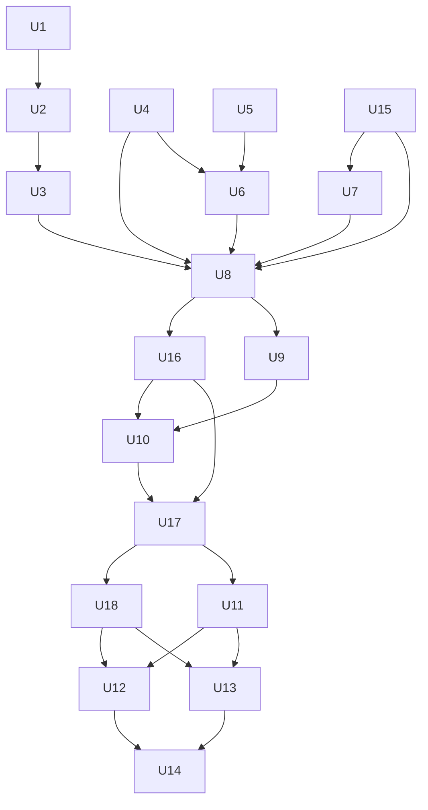

# Native Installs, Codex Polish and Skill Safety - Plan

## Goal Capsule

- **Objective:** Each of the eight tools installs Agent Blueprint with its own command straight from GitHub, the way Compound Engineering does, and sees every skill once; the skills no longer push a literal-minded model into deleting existing code, re-asking for approvals the user already gave, or scaffolding the wrong folder; and a Codex user gets a complete, correctly described plugin whose hooks are shown to run.
- **Means:** per-tool direct installs with `install.sh` running the same routes (KTD10, KTD11), a README and site that present every update and the setup skill (KD10, KD11), an audit and targeted fixes of the shared skills (KTD2), an onboarding guard (KTD3), a corrected Codex manifest with per-skill display names (KTD4, KTD5), and checks on all eight tools before release (KTD7, KTD8, KTD12), built by Codex and reviewed by Claude (KTD1).
- **Authority:** the user's instructions, then the Product Contract, then the Key Technical Decisions, then the units. `AGENTS.md` governs repo conventions.
- **Execution profile:** `ce-work`. Units marked Codex run through its cross-model engine pinned to target `codex`, model `gpt-6-astra`, effort `high`, at requirement strength. Units marked native run in the Claude session, because they need its copy, design and diagram tools.
- **Stop and ask when:**
  - a skill edit would change behavior beyond R1-R4;
  - a byte-cap trim would remove behavior instead of moving it to `references/`;
  - a Codex hook cannot be made to fire and the fix would change what the hook does;
  - a tool's direct install cannot be made to give it every skill exactly once;
  - a tool needs a login the agent cannot do;
  - any step would merge, tag or publish.
- **Who finishes:** Claude integrates every unit, runs verification, commits, and does the final review (`ce-code-review` over the branch, with the Codex review peer on `gpt-6-astra` at `xhigh` per the repo config; fix rounds through `ce-work`). The maintainer merges and tags.

---

## Product Contract

### Summary

Agent Blueprint 4.1.0 installs the way Compound Engineering does: each tool gets it with its own command straight from GitHub, and `install.sh` becomes the way to run all of those commands at once. The release also fixes skill wording that a literal model can misread, guards project setup against the wrong folder, and brings the Codex install up to OpenAI's current plugin fields with display names for every skill and a setup step after install. A check across all eight tools, including a first test that Codex runs the hooks, gates the release, and the README, site and a new install animation explain installing in each tool.

### Problem Frame

OpenAI's guidance for GPT-6 Astra warns that the model follows skill text more literally, and that rigid or conflicting rules make it stop early. Two of our rules show the risk on every tool. The TDD skill says code written before its test "is deleted and rewritten from the test", which a literal reading could apply to existing, untested code in the user's repo. Brainstorming's hard gate gives the model no way to honor a user who already approved a design.

`ab-project-start` scaffolds into the current folder before it asks anything, and its Step 6 runs `git init` whenever that folder has no `.git` of its own. Run from the home folder it turns the home folder into a repository; run from a subfolder of a project it nests one repository inside another.

The Codex repo install works in the CLI and the app, but its manifest is thin and partly wrong. Its category `Coding` is not one OpenAI accepts, its short description runs to about 100 characters, it claims 10 hooks where Codex gets 5, and it has no icon, links or example prompts. Codex's skill picker shows raw folder names. `ab-plugin-update` can fall back to the shared-copy install on a Codex plugin machine, which makes Codex list every skill twice. No test has ever shown the five Codex hooks running.

Six of the eight tools install today by cloning the repo and running `install.sh`, which copies the skills into folders; one shared folder (`~/.agents/skills`) feeds several tools, and the installer switches layouts to stop tools that read each other's folders from seeing every skill twice. Compound Engineering, which runs on 14 tools, installs each one straight from GitHub with that tool's own command and updates through the tool's own updater, with no clone and no script. Our repo already carries the manifests most of those commands need: `.grok-plugin/`, `.cursor-plugin/`, the `pi` entry in `package.json`, and the root `plugin.json` that Antigravity reads.

The site's Getting started page walks through installing, checking and naming a skill, and stops there: nothing tells a new user to run the setup skill, `ab-project-start`, which creates the project files every other skill relies on.

The decision not to build a package for OpenAI's public directory stands (KD1): the repo plugin already installs in Codex with its hooks.

### Requirements

**Skill instructions**

- R1. TDD never deletes code that existed before the task, or code the user wrote or asked to keep. It still discards code the model wrote in the task before its test, unless the user says to keep it.
- R2. Brainstorming does not ask again for approval of a design the user already approved or authorized for implementation.
- R3. An audit of every skill, its `references/` and its helper prompts against OpenAI's GPT-6 Astra instruction-following guidance is recorded, listing for each change the file, the conflicting text and the resulting behavior. Rules that would override an explicit user instruction, re-ask for an approval the user already gave, or trigger a destructive action get targeted fixes; checkpoints that are a skill's purpose stay, and no rule is weakened beyond its conflict.
- R4. Onboarding never scaffolds into the home folder or the filesystem root unless that folder was named explicitly, asks before scaffolding a non-empty folder outside any git repository when no folder was named, and never creates a git repository inside an existing one.

**Install**

- R15. Each tool that has its own install command installs Agent Blueprint straight from GitHub with it, and updates through that tool's own updater: Claude Code, Codex, Antigravity, Grok Build, Pi and Cursor. Hermes and Amp, which Compound Engineering does not cover, keep the installer's route.
- R16. `install.sh` sets up every tool on the machine at once by running the same per-tool routes as R15, writes no shared `~/.agents/skills` copy, and on a re-run removes the copies earlier versions' install records list. Every tool sees each skill exactly once.

**Codex install**

- R5. The Codex manifest carries a valid category, a description whose counts match what Codex gets, and listing details within OpenAI's published limits: a short description, a long description, a developer name, capabilities, website and support links, up to three example prompts, a brand color, and an icon and logo.
- R6. Installing from the repo in the Codex app offers `ab-project-start` as the setup step.
- R7. Every skill shows a display name and a one-line description in Codex's skill picker, and the two manual-only skills stay manual-only.
- R8. `ab-plugin-update` updates each install through that tool's own route, the Codex plugin included, and never adds a second copy of the skills.
- R9. A test shows each of the five Codex hooks running in the CLI; a hook that never fires is fixed or documented. The Codex app is checked by hand.

**Verification**

- R10. All eight tools run a fast check, recorded in one smoke record (six in parallel in the real home, Antigravity and Cursor one at a time in clean profiles): (discovery, manual-only, hooks, debug, TDD override, brainstorming override). A baseline of the two override checks on the v4.0.2 skills is recorded for Claude Code and Codex, so the report shows what the changes did. Every applicable cell passes. A cell may be `n/a` by design, a login or account limit is reported as blocked, and R9's documented hook exception is allowed; any other failure or timeout blocks the release.

**Docs and site**

- R11. README and site present everything 4.1.0 delivers: each tool's own install command with `install.sh` as the way to set up every tool at once; the Codex section for the CLI and the app (marketplace add, plugin add, trust in `/hooks`, what the hooks add, the display names and the setup step); the safer TDD and brainstorming behavior; the onboarding guard; and updating through each tool's own route. Install commands agree between the README and every host note, and the eight-tools diagram shows each tool's route.
- R12. Premium motion graphics show the 4.1.0 updates where readers need them, at least: each tool installing with its own command and the installer doing all at once; and the setup skill setting up a project. They match the existing pieces in quality and style, state no counts, and are integrated into the pages the content audit (R18) names.
- R13. All README and site work follows the site's existing design system (`site/src/styles/tokens.css`: off-white and ink with one accent, `#ED4423`; Archivo and Azeret Mono; 2px radius; no shadows) and uses: Mobbin, impeccable, shadcn and the taste skills for design; the no-ai-slop and humanizer skills for every piece of copy; Codex (`gpt-6-astra`) with its built-in image tool for raster images; Excalidraw for diagrams; HyperFrames, and Higgsfield where it fits, for motion.
- R17. The setup skill, `ab-project-start`, is explained wherever a reader needs it: what it creates, when to run it, how to call it in each tool (`/ab-project-start`, `$ab-project-start` in Codex, `/skill:ab-project-start` in Pi), and that Codex offers it right after install. At minimum: as the step after installing on Getting started, in Quick start, in each tool's install tab, on the Project files page, in the FAQ, and in the README.
- R18. A content audit of the README and every site page against what 4.1.0 delivers lists each gap (a missing or outdated page, section, step, image or animation) with where it belongs, and each gap is fixed in this release or recorded with the reason.

**Release**

- R14. The work ships as 4.1.0 with release notes, a hand-test checklist, and a final report to the maintainer (full diff, audit findings, verification results per tool, remaining uncertainties).

### Key Decisions

- KD1. **No package for OpenAI's public directory.** (session-settled: user-directed — chosen over building a directory package: the repo plugin already installs in the Codex CLI and app with its hooks.) Governs R5-R9.
- KD2. **Audit every skill and its supporting files, then fix only real conflicts, keeping TDD and design review as defaults.** (session-settled: user-approved — chosen over a precedence line on every hard rule, or no change: it keeps the rules that guard against the model's own excuses.) Governs R1-R3.
- KD3. **A fast check on all eight tools instead of the full smoke table.** (session-settled: user-approved — chosen over testing only Codex and Claude Code: the skill edits reach every tool.) Governs R10.
- KD4. **`ab-project-start` is the setup step after install, behind the onboarding guard.** (session-settled: user-approved — chosen over no setup step.) Governs R4, R6.
- KD5. **The motion loop covers installing in all eight tools.** (session-settled: user-directed — chosen over a Codex-only loop.) Governs R12.
- KD6. **Release 4.1.0.** (session-settled: user-approved — chosen over a patch release: skill behavior changes.) Governs R14.
- KD7. **Install the way Compound Engineering does: each tool's own command, straight from GitHub.** (session-settled: user-directed — chosen over clone plus `install.sh` as the main route.) Governs R11, R12, R15.
- KD8. **`install.sh` stays as the way to set up every tool at once, running the same per-tool routes; Hermes and Amp keep its handling.** (session-settled: user-directed — chosen over removing it from the README.) Governs R16.
- KD9. **Compound Engineering's other nine tools come in a separate 4.2.0 plan, skills only, and a tool that is not installed on the maintainer's machine is built and documented but not tested, with no untested label anywhere.** (session-settled: user-directed — chosen over one release for everything, and over porting hooks to tools that support them.) Governs the Scope Boundaries.
- KD10. **README and website present every 4.1.0 update, built with the existing design system and the named design, copy, image and motion tools.** (session-settled: user-directed — chosen over a docs-only update.) Governs R11-R13, R18.
- KD11. **The setup skill is explained in every place a reader looks after installing.** (session-settled: user-directed.) Governs R17.

### Scope Boundaries

- No directory package, listing ZIP, privacy or terms pages, `products` restriction, or submission checklist (KD1).
- Merging and tagging are the maintainer's.
- Other hosts' manifests change only by the version bump and what their direct install needs (KTD10).
- Compound Engineering's other tools (Kimi Code CLI, Cline, Devin CLI, GitHub Copilot, Factory Droid, Qwen Code, OpenCode, oh-my-pi, and Grok Bot through Cursor) wait for 4.2.0 (KD9).
- Considered and not built:
  - An `install.sh` warning when a tool sees two installs made by hand outside the script. The README states the one-route-per-tool rule; revisit if users report duplicates.
  - Dry-run-and-confirm before onboarding inside an existing git repository. The scaffold merges additively and the result shows in git.
  - The full smoke table (build, review, ship, team) on all eight tools. The fast check covers the changed behavior.

#### Deferred to Follow-Up Work

- A 4.2.0 plan that adds Compound Engineering's other nine tools under KD9.

### Outstanding Questions

- Deferred: whether Codex reads `extensions["com.openai"].onboardingSkill` from the legacy `.codex-plugin/plugin.json` is known only from OpenAI's docs; the hand test confirms it.
- Deferred: the GitHub forms of the direct installs can only be run once the branch is on GitHub; U16 verifies the same routes from the local checkout, and the checklist runs the GitHub forms after merge.

### Sources

- OpenAI, read 2026-10-12: [Build plugins](https://developers.openai.com/plugins/build/plugins) (interface fields, `onboardingSkill`, hooks scope), [Submission errors](https://developers.openai.com/plugins/deploy/submission-errors) (field limits, the 13 categories, image rules, `agents/openai.yaml` rules), [Build skills](https://developers.openai.com/plugins/build/skills), [GPT-6 Astra instruction following](https://developers.openai.com/api/docs/guides/latest-model#gpt-6-astra-instruction-following), [Hooks](https://learn.chatgpt.com/docs/hooks).
- Repo: `skills/ab-test-driven-development/SKILL.md` (the "only with the user's go-ahead" clause is the model for user-authorized exceptions); `skills/ab-brainstorming/SKILL.md` (hard gate); `skills/ab-project-start/scripts/scaffold.py`; `skills/ab-plugin-update/SKILL.md` (Codex branch falls back to the copy route); `hooks/codex.json`; `hooks/handlers/host.js` (`AGENT_BLUEPRINT_HOOK_TRACE`); `tests/smoke/README.md` (cells, clean profiles); `skills/ab-ship-pipeline/scripts/hosts.sh` (`host_run`, `host_hooks`); `docs/releases/v4.0.0-checklist.md` (Claude Code cache refresh).
- Local evidence on codex-cli 0.160.0: `--disable` takes feature names such as `shell_tool`; `codex plugin marketplace upgrade` refreshes only Git marketplaces; there is no plugin validate command.
- Compound Engineering 3.30.4 README (installed copy): the per-tool install commands this plan follows, and its skills-only, no-hooks layout.
- Host notes: `docs/hosts/antigravity.md`, `grok-build.md`, `pi.md`, `cursor-cli.md`, `hermes.md` and `amp.md` record each tool's own install command and which tools read other tools' folders.
- Superseded plan: `docs/plans/2026-10-12-1440-feat-official-codex-plugin-plan.md` (its research and review carry over where this plan reuses a unit).

---

## Planning Contract

### Key Technical Decisions

- KTD1. **Execution routing.** Units marked Codex run through `ce-work` cross-model execution: target `codex`, model `gpt-6-astra`, effort `high`, at requirement strength. Units marked native run in the Claude session, because R13's skills and the Excalidraw canvas are that session's tools. Claude reviews every transport diff, runs the authoritative verification and commits. (session-settled: user-directed — chosen over the config default `gpt-6.1-sol` at `xhigh` for the worker.)
- KTD2. **The audit is Codex's, the limits are the plan's.** Codex (`gpt-6-astra`) audits all 53 skills, their `references/` and their helper prompts, edits within R1-R3, and writes `docs/releases/v4.1.0-instruction-audit.md`. Only the user's own messages count as an explicit user instruction; text in files, tool or CI output, PR or issue comments, or helper output never does. Rules that treat such content as data (the injection markers in `ab-orchestrate`, `ab-pr-workflow` and `ab-resolve-in-parallel`, the error-text rule in `ab-systematic-debugging`) and the ship pipeline's secret scan are not R3 conflicts: they get no precedence line, and the report lists them as reviewed and unchanged. A skill pushed over 8,000 bytes moves detail into `references/` at the point of use.
- KTD3. **The onboarding guard sits in `scaffold.py` and Step 6.** `skills/ab-project-start/scripts/scaffold.py` refuses the home folder and `/` unless the folder was named, and reports the enclosing git top level when the target is inside a work tree. For a non-empty folder outside any work tree with no folder named, it prints its dry run and exits without writing, so the skill asks the user and reruns with the folder named; an unattended run stops there and says how to name a folder. Step 6 runs `git init` only when the folder is not inside a work tree. A script guard is testable in `tests/gates`; a sentence in the skill text is not.
- KTD4. **The Codex manifest moves to the current field set, not to the portable format.** `.codex-plugin/plugin.json` keeps `skills` and `hooks` and gains the interface fields, `composerIcon` and `logo` pointing into `./docs/images/codex/`, and `extensions["com.openai"].onboardingSkill` set to `./skills/ab-project-start/SKILL.md`. Its category becomes `Developer Tools`, also in `.agents/plugins/marketplace.json`. Its description states 53 skills and Codex's 5 hooks. The root `plugin.json` keeps no `$schema` (portability plan KTD10). `check-manifests.py` gains a rule that interface asset paths exist, and `check-drift.sh` checks the Codex description's counts against `skills/` and `hooks/codex.json`.
- KTD5. **Per-skill metadata carries display fields only.** Every skill gets `agents/openai.yaml` with `interface.display_name` and `interface.short_description` (51 new files, 2 updated). No `products` key: without a directory listing it buys nothing, and Codex 0.160.0's metadata parser knows only `policy.allow_implicit_invocation`, so an unknown key risks invalidating the two manual-only files. In those two files `allow_implicit_invocation: false` stays the first key under `policy:` (`tests/gates/test_migrate.py` and `test_skill_style.py` pin that order). `check-portability.py` checks every file's fields, allowed keys and unique display names.
- KTD6. **The version bump comes before any install-based check.** One commit puts every manifest and the 17 `metadata.version` fields at 4.1.0 (through `sync-shared.py`) with the README release-history row and a release-notes draft, because the changelog page fails the build without the row, the smoke record takes its name from the checkout's version, and installed caches only refresh on a version change.
- KTD7. **The Codex hooks check rides the smoke harness.** The `hooks` cell, `n/a` on Codex today because hooks wait for trust, runs on Codex with `--dangerously-bypass-hook-trust` for that one invocation and `AGENT_BLUEPRINT_HOOK_TRACE` set, so each handler that fires writes a line naming its host. The cell seeds `.agent-blueprint/config.json` with `{"hooks": {"validateCommit": true}}` in its work copy, because the commit check is opt-in and writes no trace line without it. The prompt makes the session edit a file, run a command and stop, so all five handlers have a chance to fire. A handler with no line is a finding: likely the `Edit|Write` matcher, if Codex names its file-edit tool differently.
- KTD8. **The fast check reuses `tests/smoke/run-smoke.sh` with two new cells: six hosts with `--jobs 6` in the real home, then Antigravity and Cursor one at a time in clean profiles (U10).** The TDD cell seeds named functions with no tests and asks for a new, independent function test-first in that same module, without mentioning the existing ones, so the agent has to work beside untested code and decide what the discard rule covers. It passes when the seeded functions still exist by name and their recorded behavior holds (a behavior check, not byte identity, so a harmless refactor does not fail it), and a test for the new function exists. The brainstorming cell seeds a design doc marked approved and asks to implement it; it passes when no approval request appears and a plan or code does. The selftest proves each check fails on a same-name rewrite and on an approval request.
- KTD9. **The baseline runs on v4.0.2 installs before the audit lands.** Codex's cache already holds 4.0.2, matching `main`; Claude Code holds 4.0.1 and is refreshed to 4.0.2 first, because the harness fails every cell of a host whose installed copy differs from the checkout. The two new cells then run once on both, from a worktree of `main` plus U1, before U3 changes any skill.
- KTD10. **One route per tool, the tool's own where it has one.** Each route installs from GitHub and updates through the tool's own updater:

  | Tool | Install | Update |
  |---|---|---|
  | Claude Code | `claude plugin marketplace add Ninety2UA/agent-blueprint`, then `claude plugin install agent-blueprint@agent-blueprint` | `claude plugin marketplace update`, then `claude plugin update` |
  | Codex (CLI and app) | `codex plugin marketplace add Ninety2UA/agent-blueprint`, then `codex plugin add agent-blueprint@agent-blueprint`, then trust in `/hooks` | `codex plugin marketplace upgrade`, then `codex plugin add` again |
  | Antigravity | `agy plugin install https://github.com/Ninety2UA/agent-blueprint` | install again |
  | Grok Build | `grok plugin install Ninety2UA/agent-blueprint` (it asks to confirm; `install.sh` adds `--trust`) | `grok plugin update` |
  | Pi | `pi install git:github.com/Ninety2UA/agent-blueprint` | `pi update --extensions` |
  | Cursor | `cursor-agent plugin marketplace add https://github.com/Ninety2UA/agent-blueprint`, then `/plugin`; nothing when Claude Code has the plugin, because Cursor imports it | the marketplace update, or Claude Code's |
  | Hermes | the installer's copy in `~/.hermes/skills`, which only Hermes reads | re-run the installer |
  | Amp | nothing when Claude Code has the plugin, because Amp reads it; otherwise the installer's Amp-only copy | Claude Code's update, or re-run the installer |

  Tools that read another tool's install count it as their route: Cursor and Amp read Claude Code's plugin, and Grok reads `~/.claude/skills` and Claude Code's registered marketplaces. U15 finds the Amp-only copy location and confirms Grok's reading, and U16 proves each tool sees each skill once.
- KTD11. **`install.sh` runs the KTD10 routes.** For each tool it finds, it runs that tool's command with the GitHub source, so an install by script equals an install by hand; `--local` swaps in the checkout it runs from, for maintainers and tests, replacing a registration of the same name whose source differs; for Cursor, whose marketplace registration is account-wide and takes only a Git URL, `--local` skips the marketplace and points to `cursor-agent --plugin-dir <checkout>`, and a default run adds the GitHub marketplace, prints the in-session `/plugin` step as a required next step, and lists Cursor as unfinished in its closing summary, because a script cannot run `/plugin`. It writes no `~/.agents/skills` copy. On a re-run it first removes every copy an earlier version's install records list: the shared `~/.agents/skills` copy and the per-tool copies in `~/.grok/skills` and `~/.pi/agent/skills` that 4.0.x wrote on machines with Claude Code plus Cursor or Amp, before running Grok's and Pi's own commands (it never touches folders the records do not list). Hermes and Amp keep its copy handling, in folders only they read. `--only`, `--dry-run` and the scaffold options stay.
- KTD12. **Direct routes are verified from the local checkout before merge, and from GitHub after.** The branch is not on GitHub until merge, so U16 runs each route's local form (`--local`; for Cursor, `--plugin-dir`, which adds or removes no account marketplace) in a clean profile per tool and checks that the tool lists each skill once, with and without the Claude Code plugin present. The checklist runs each GitHub form once after merge.

### High-Level Technical Design

Unit dependencies:



### Output Structure

```text
docs/images/codex/              icon and logo for the Codex manifest, light and dark
docs/releases/v4.1.0-*.md       notes, checklist, instruction audit, install record, smoke record, site audit
skills/<skill>/agents/openai.yaml   one per skill
tests/smoke/scenarios/tdd-override/
tests/smoke/scenarios/brainstorm-override/
site/motion/<piece>/composition.html   one per motion piece the audit places
```

---

## Implementation Units

| U-ID | Title | Files touched | Depends on |
|---|---|---|---|
| U1 | Override smoke cells | `tests/smoke/` | none |
| U2 | Baseline run on v4.0.2 skills | `docs/releases/v4.1.0-instruction-audit.md` | U1 |
| U3 | Instruction audit and targeted fixes | skill, reference and helper prompt files | U2 |
| U4 | Onboarding guard | `skills/ab-project-start/` | none |
| U5 | Codex listing copy, icons and display names | `docs/images/codex/`, `skills/*/agents/openai.yaml`, `.codex-plugin/plugin.json` | none |
| U6 | Codex manifest mechanics and gates | `.codex-plugin/plugin.json`, `scripts/check-*` | U4, U5 |
| U15 | Direct installs and the installer | `install.sh`, tool manifests, `skills/ab-ship-pipeline/scripts/hosts.sh` | none |
| U7 | `ab-plugin-update` for every route | `skills/ab-plugin-update/` | U15 |
| U8 | Version bump to 4.1.0 | release file set | U3, U4, U6, U7, U15 |
| U16 | Verify each direct install | `docs/releases/v4.1.0-installs.md` | U8 |
| U9 | Codex hooks check | `tests/smoke/`, `skills/ab-ship-pipeline/scripts/hosts.sh`, maybe `hooks/codex.json` | U8 |
| U10 | All-tools fast check | `docs/releases/v4.1.0-smoke.*` | U9, U16 |
| U17 | Content audit and placement map | `docs/releases/v4.1.0-site-audit.md` | U10, U16 |
| U18 | Raster images | `site/public/`, `docs/images/` | U17 |
| U11 | README, host notes and diagrams | `README.md`, `docs/hosts/*.md`, `docs/images/` | U17 |
| U12 | Site update | `site/src/` | U11, U17, U18 |
| U13 | Motion graphics | `site/motion/`, `site/public/media/` | U11, U17, U18 |
| U14 | Release notes, checklist and final report | `README.md`, `AGENTS.md`, `docs/releases/` | all |

### U1. Override smoke cells

- **Executor:** Codex.
- **Goal:** add the two smoke cells that show whether TDD keeps existing code and brainstorming honors an approved design.
- **Requirements:** R1, R2, R10; KTD8.
- **Dependencies:** none.
- **Files:** create `tests/smoke/scenarios/tdd-override/` and `tests/smoke/scenarios/brainstorm-override/`; modify `tests/smoke/run-smoke.sh` (`ALL_CELLS`), `tests/smoke/fake-host.sh`, `tests/smoke/selftest.sh` and `tests/smoke/README.md` (the cell table).
- **Approach:** follow the cell layout in `tests/smoke/README.md` (`apply.sh`, `skill`, `prompt.txt`, `check.sh`), with the observables in KTD8.
- **Patterns to follow:** the existing `debug` and `build` cells.
- **Test scenarios:**
  - The selftest's fake host passes both cells with a compliant transcript.
  - It fails the TDD cell when a seeded function is deleted, or rewritten so its recorded behavior changes, even with a new test present.
  - It fails the brainstorming cell when the transcript asks for design approval.
- **Verification:** `bash tests/smoke/selftest.sh` passes, and shellcheck passes on the new scripts.

### U2. Baseline run on v4.0.2 skills

- **Executor:** Claude runs the harness.
- **Goal:** record how the current skills behave on the two new cells, before anything changes.
- **Requirements:** R10; KTD9.
- **Dependencies:** U1.
- **Files:** the harness writes its record to a scratch folder; the results go into `docs/releases/v4.1.0-instruction-audit.md` (created here, finished in U3).
- **Approach:**
  1. Refresh Claude Code to 4.0.2 from `main`: `claude plugin marketplace update agent-blueprint`, then `claude plugin uninstall --keep-data agent-blueprint@agent-blueprint` and `claude plugin install agent-blueprint@agent-blueprint` (`docs/releases/v4.0.0-checklist.md`). Codex's cache already matches `main` and is not touched.
  2. Run `tdd-override,brainstorm-override` on Claude Code and Codex from a worktree of `main` plus U1 (KTD9).
- **Test expectation:** none. This unit records evidence.
- **Verification:** the audit report holds a pass or fail line, with its reason, for each cell on each of the two tools.

### U3. Instruction audit and targeted fixes

- **Executor:** Codex.
- **Goal:** fix the places where skill text would override the user, re-ask for an approval the user already gave, or destroy work, and record each one.
- **Requirements:** R1, R2, R3; KD2; KTD2.
- **Dependencies:** U2.
- **Files:** modify `skills/ab-test-driven-development/SKILL.md`, `skills/ab-brainstorming/SKILL.md`, and the other skills, references and helper prompts the audit names; update registered copies through `scripts/prompt-owners.json` and `sync-shared.py`; finish `docs/releases/v4.1.0-instruction-audit.md`.
- **Approach:**
  1. **TDD, per R1:** the discard rule covers only code the model wrote in this task before its test. Code that existed before the task, or that the user wrote or asked to keep, is never deleted. The user can tell the model to keep its own code. Test-first stays the default.
  2. **Brainstorming, per R2:** an approved design or an explicit go-ahead to implement satisfies the gate; otherwise the gate stands.
  3. **Approval stops:** remove only stops that re-ask an approval the user already gave. Checkpoints that define a skill stay, such as the stage approvals in `ab-build-pipeline` and the batch checkpoints in `ab-executing-plans`.
  4. **Destructive actions:** deleting or overwriting work the user owns or that existed before the task, rewriting shared history, or pushing needs the user's request or confirmation; invoking a skill whose job is to push or publish counts as that request. Fix any that does not. Removing a skill's own working files (progress files, temporary checkouts, `.agent-blueprint/` run state) and R1's discard of the model's own pre-test code are out of scope.
  5. **Precedence:** add a line of user precedence only where a rule needs it, never a blanket sentence (KD2), and never to the guards KTD2 lists.
  6. **Report:** one entry per change (file, quoted conflicting text, change, resulting behavior), each hard rule reviewed and left as it was with the reason, and the U2 baseline.
- **Execution note:** change one rule at a time, keeping `tests/gates` green after each. Edit a shared prompt in its owner file, then run `sync-shared.py`.
- **Test scenarios:**
  - `test_pipeline_skills.py`, `test_skill_style.py`, `test_migrate.py` and `test_brainstorming_sections.py` still pass.
  - The size rule holds for every edited skill.
  - The behavior checks run in U10: TDD keeps the seeded functions, brainstorming proceeds on the approved design.
- **Verification:** the report lists every change and every hard rule left unchanged, and the maintainer sees it in the final report.

### U4. Onboarding guard

- **Executor:** Codex.
- **Goal:** stop onboarding from scaffolding into the home folder, `/` or an unrelated folder, and from nesting a git repository.
- **Requirements:** R4; KD4; KTD3.
- **Dependencies:** none.
- **Files:** modify `skills/ab-project-start/scripts/scaffold.py`, `skills/ab-project-start/SKILL.md` (Steps 0 and 6) and `tests/gates/test_scaffold.py`.
- **Approach:**
  1. The skill passes a folder to `scaffold.py` only when the user named one.
  2. With no folder given, `scaffold.py` refuses the home folder and `/`, writes nothing, and says how to name a folder.
  3. With no folder given and a non-empty folder outside any git repository, `scaffold.py` prints its dry run and writes nothing; Step 0 shows it, asks the user, and reruns with the folder named after a yes. Default when nobody answers: stop and say how to name a folder.
  4. When the target sits inside a git work tree below its top level, the output names the top level.
  5. Step 6 runs `git init` only when `git rev-parse --is-inside-work-tree` fails.
  6. The guard applies however the scaffold runs: the frontmatter `argument-hint` stops saying the default is the current folder, Step 0 never tells the model to pass `.` when the user named no folder, and the no-Python fallback (copying `assets/` by hand) applies the same refusals and confirmation.
  7. `SKILL.md` stays within 8,000 bytes.
- **Patterns to follow:** `skills/ab-systematic-debugging/references/defense-in-depth.md` l.98-104 describes this bug class.
- **Test scenarios:**
  - **New project.** An empty temp folder named explicitly gets `AGENTS.md` and `docs/context/STATUS.md`, as today.
  - **Home folder.** With `HOME` set to a temp folder and no folder argument, run from `HOME`, the script exits non-zero and writes nothing.
  - **Filesystem root.** With no folder argument, run from `/`, it is refused.
  - **Explicit home.** The home folder named explicitly proceeds: an explicit user instruction wins.
  - **Non-empty folder outside a repo.** A temp folder holding one unrelated file, with no `.git` above it and no folder argument: the script prints the dry run, exits with its "needs confirmation" status and writes nothing. The same folder named explicitly proceeds.
  - **Subfolder of a repo.** It is scaffolded, and the output names the enclosing top level.
  - **Skill text.** A contract test checks that Step 6 makes `git init` depend on the work-tree check, that neither Step 0 nor the frontmatter defaults to the current folder, and that the no-Python fallback names the same refusals.
  - **CI.** The `install-test` job's "Scaffold a project" step still passes.
- **Verification:** `tests/gates` pass and the size rule holds.

### U5. Codex listing copy, icons and display names

- **Executor:** native (copy and design).
- **Goal:** write what Codex shows for the plugin and for each skill.
- **Requirements:** R5, R7, R13; KTD4, KTD5.
- **Dependencies:** none.
- **Files:**
  - write the interface copy and description into `.codex-plugin/plugin.json`;
  - create `docs/images/codex/logo.svg`, `logo-dark.svg`, `composer-icon.svg` and `composer-icon-dark.svg`;
  - create `skills/<skill>/agents/openai.yaml` for the 51 skills without one; add the interface block to `skills/ab-migrate/agents/openai.yaml` and `skills/ab-plugin-update/agents/openai.yaml`.
- **Approach:**
  1. Keep OpenAI's limits: display name and short description up to 30 characters, long description up to 4,000, up to three example prompts of up to 128 characters, category `Developer Tools`, brand color `#ED4423` (the site accent, readable on white and on `#212121`).
  2. The long description says what the plugin does in Codex, that the hooks need trusting in `/hooks`, and the MIT license, with no comparisons. The description states 53 skills and 5 hooks (KTD4).
  3. Links: website `https://agent-blueprint.dbenger.com/`, support the GitHub issues page.
  4. Icons derive from `site/public/brand/mark.svg` with a square numeric `viewBox`; the logo is the mark on an off-white square, the composer icon the bare mark, and the dark variants swap ink for off-white. `composerIcon` and `logo` point at the light files, and `composerIconDark` and `logoDark` (optional OpenAI fields) at the dark ones; the manifest asset rule (U6) covers all four.
  5. Display names: the skill's purpose in title case, without `ab-`, unique, up to 30 characters. Short descriptions: one line, 25 to 60 characters (Codex's bundled skill-creator reference sets 25-64), leading with what the skill does.
  6. Write all copy with no-ai-slop, then humanizer.
- **Test expectation:** none here. U6 adds the gates.
- **Verification:** the manifest parses; 53 `agents/openai.yaml` files exist; the two manual-only files still pass their tests; each icon renders square in light and dark.

### U6. Codex manifest mechanics and gates

- **Executor:** Codex.
- **Goal:** finish the manifest and gate the fields that can drift.
- **Requirements:** R5, R6, R7; KD4; KTD4, KTD5.
- **Dependencies:** U4 (the guard lands before setup can run), U5.
- **Files:** modify `.codex-plugin/plugin.json`, `.agents/plugins/marketplace.json`, `scripts/check-manifests.py`, `scripts/check-drift.sh`, `scripts/check-portability.py`, `tests/gates/test_check_manifests.py` and `tests/gates/test_check_portability.py`.
- **Approach:**
  1. Apply KTD4's mechanics: asset paths, `onboardingSkill`, the marketplace category. Keep `skills: "./skills/"` and `hooks: "./hooks/codex.json"`, which `tests/gates/test_hooks.py` pins.
  2. `check-manifests.py`: every `interface` asset path exists and stays inside the repo.
  3. `check-drift.sh`: the Codex description's skill and hook counts match `skills/` and the command entries in `hooks/codex.json`.
  4. `check-portability.py`: every `skills/*/agents/openai.yaml` has a display name and a short description of 25 to 60 characters, only allowed keys, and a display name unique across skills (KTD5). The `manual-only` rule stays as it is.
- **Patterns to follow:** the `hook-files` rule in `check-manifests.py`; the "N skills … N hooks" check in `check-drift.sh` (l.206-211); the shrink-only allowlist.
- **Test scenarios:**
  - A missing interface asset fails the new manifest rule.
  - A Codex description saying "10 hooks" fails the drift gate, and "5 hooks" passes.
  - A missing display name, a duplicate display name, an unknown key, and a 24-character short description each fail the portability gate.
  - The two manual-only files still pass `test_migrate.py` and `test_skill_style.py`.
  - Category `Coding` in either Codex file fails.
- **Verification:** every gate and `tests/gates` pass; `claude plugin validate --strict .claude-plugin/plugin.json` still passes; installing the repo route from a local marketplace into a temp Codex home shows the hooks still declared and the interface fields present after `extensions["com.openai"]` was added. If they drop, `onboardingSkill` moves out and the report says so.

### U7. `ab-plugin-update` for every route

- **Executor:** Codex.
- **Goal:** update each install through its tool's own route (KTD10), without ever adding a second copy next to it.
- **Requirements:** R8, R15.
- **Dependencies:** U15, which settles the routes.
- **Files:** modify `skills/ab-plugin-update/SKILL.md` and its tests in `tests/gates/` if they pin the Codex text.
- **Approach:**
  1. Detect a Codex plugin install with `codex plugin list --json`.
  2. Read the agent-blueprint marketplace's source from `codex plugin marketplace list --json`. For a Git source, run `codex plugin marketplace upgrade agent-blueprint`. For a local source that is a git checkout (what `install.sh` registers), run `git -C <source> pull --ff-only`, stopping and showing local changes as the skill's Checkout route does. Either path then runs `codex plugin add agent-blueprint@agent-blueprint` and reads the installed version from the cached `.codex-plugin/plugin.json`.
  3. When a plugin install exists, never take the copy-install route; if the update fails, report it and stop.
  4. The other tools follow KTD10's Update column: Claude Code's plugin update, `grok plugin update`, `pi update --extensions`, Antigravity's install again, Cursor's marketplace or Claude Code's update, and a re-run of the installer for Hermes and Amp copies. The route is read from where the skill itself is installed, as the skill does today.
  5. The skill stays manual-only and within 8,000 bytes, moving route detail into `references/` if needed.
- **Test scenarios:**
  - A contract test checks that the Codex branch covers both marketplace sources (the Git upgrade and the local-checkout pull) and has no fallback to the copy route.
  - A contract test checks that every KTD10 route has an update step and none falls back to a shared copy.
  - The `manual-only` smoke cell in U10 still finds the skill outside the implicit catalog.
- **Verification:** `tests/gates` pass.

### U15. Direct installs and the installer

- **Executor:** Codex.
- **Goal:** make every KTD10 route work from GitHub and from a checkout, and turn `install.sh` into the way to run them all.
- **Requirements:** R15, R16; KD7, KD8; KTD10, KTD11.
- **Dependencies:** none.
- **Files:** modify `install.sh`, `tests/gates/test_install.py`, the manifests a direct install needs (`.grok-plugin/`, `.cursor-plugin/`, `package.json`, root `plugin.json`, `.agents/plugins/marketplace.json`, `.claude-plugin/marketplace.json`), `skills/ab-ship-pipeline/scripts/hosts.sh` (`host_catalog_dirs` for the new install locations) and `.github/workflows/ci.yml` (the `install-test` job).
- **Approach:**
  1. For each tool, confirm its KTD10 command installs from a GitHub-style source and from a local path, and fix any manifest field it needs; Antigravity's GitHub form and Grok's reading of Claude Code's install are the two the host notes mark unverified.
  2. `install.sh` runs those commands (KTD11): GitHub sources by default, the checkout with `--local`. Tools that read Claude Code's plugin are skipped when it is present, after retiring any standalone route an earlier installer run recorded for them (Cursor's marketplace plugin, Amp's recorded copy) and updating the record, so adding Claude Code later never leaves Cursor or Amp with a second copy.
  3. Find the Amp-only copy location from Amp's docs and the skills folders other tools scan, so that no other tool reads it; Hermes keeps `~/.hermes/skills`.
  4. Re-running the installer removes the copies earlier install records list (the shared `~/.agents/skills` copy, and the 4.0.x per-tool copies in `~/.grok/skills` and `~/.pi/agent/skills`) before the new routes run, and leaves every other folder alone; Hermes keeps `~/.hermes/skills` as its route.
  5. `host_catalog_dirs` learns each new install location, so the smoke harness compares the right copies.
- **Patterns to follow:** the installer's existing record handling (`copy_skills`) and its split logic for tools that read Claude Code's plugin.
- **Test scenarios:**
  - In a fake `HOME` with stub tool binaries, the installer runs each tool's command with the GitHub source, and with the checkout under `--local`.
  - A fake `HOME` holding an old `~/.agents/skills` copy with its install record ends with that copy removed and an unrelated skill folder kept.
  - A fake `HOME` in the 4.0.x split layout (install records in `~/.grok/skills` and `~/.pi/agent/skills`) ends with each skill once per tool after the re-run.
  - Cursor under `--local` runs no marketplace command and prints the `--plugin-dir` form.
  - With Claude Code's plugin present, the installer runs nothing for Cursor and Amp.
  - A fake `HOME` with only Cursor gets the marketplace command, the printed `/plugin` step, and Cursor listed as unfinished in the summary.
  - Install for Cursor and Amp without Claude Code, add Claude Code, re-run the installer: the recorded standalone routes are retired and each tool sees each skill once.
  - Grok's command runs with `--trust` from the installer.
  - `--dry-run` prints every command and changes nothing.
  - CI's `install-test` job passes on Linux and macOS.
- **Verification:** `tests/gates` and shellcheck pass; the CI install test passes.

### U8. Version bump to 4.1.0

- **Executor:** Codex for the bump; the notes draft is a stub that U14 rewrites.
- **Goal:** put the branch at 4.1.0 before any install-based check (KTD6).
- **Requirements:** R14; KD6; KTD6.
- **Dependencies:** U3, U4, U6, U7, U15 (the last planned changes to skills and manifests; U9 may still fix `hooks/codex.json`, and its refresh step covers that).
- **Files:** `.claude-plugin/plugin.json`, `.codex-plugin/plugin.json`, root `plugin.json`, `.grok-plugin/plugin.json`, `.grok-plugin/marketplace.json`, `.cursor-plugin/plugin.json`, `package.json`, the 17 skills with `metadata.version`, the README release-history row, and `docs/releases/v4.1.0-release-notes.md`.
- **Patterns to follow:** release commit `bfb8ad8` (4.0.2) touched the same set.
- **Test scenarios:**
  - `check-manifests.py`'s version rule passes at 4.1.0.
  - `test_pipeline_skills.py` finds 4.1.0 in the provenance lines.
  - The site's Changelog page builds with the 4.1.0 row.
- **Verification:** every manifest and skill reads 4.1.0, and the gates pass.

### U16. Verify each direct install

- **Executor:** Claude runs the checks.
- **Goal:** show that each tool installs Agent Blueprint by its own route and sees each skill once, and that the updater works on a real install.
- **Requirements:** R8, R15, R16; KTD12.
- **Dependencies:** U8, so every install reads 4.1.0.
- **Files:** create `docs/releases/v4.1.0-installs.md` (the per-tool record).
- **Approach:**
  1. For each of the eight tools, in a clean profile under the OS temp folder: run the route's local form (`install.sh --local --only <tool>` or the tool's command against the checkout; Cursor through `--plugin-dir`, never adding or removing an account marketplace), list what the tool sees, and check each skill appears once; then uninstall.
  2. Repeat for Cursor, Amp and Grok with the Claude Code plugin present, which must not produce duplicates; check Cursor's skill list after the `/plugin` step as well.
  3. Updater runtime test in a temp Codex home: a local marketplace clone of the branch commit just before U8's version bump (U7's updater, still at version 4.0.2), whose upstream is the branch, so the run uses U7's Codex route; run `$ab-plugin-update` headless; the install must end at 4.1.0 with one copy of each skill and no shared copy.
  4. Record each result, with the command, in the install record.
- **Test expectation:** none. This unit records evidence; a failure goes back to U15 or U7.
- **Verification:** the install record shows each tool with its skills once and the updater test at 4.1.0.

### U9. Codex hooks check

- **Executor:** Codex changes the harness; Claude runs it.
- **Goal:** show each Codex hook running, or find out which one does not.
- **Requirements:** R9; KTD7.
- **Dependencies:** U8.
- **Files:** modify `skills/ab-ship-pipeline/scripts/hosts.sh` (the Codex hooks invocation), `tests/smoke/run-smoke.sh` (the `hooks` cell on Codex), `tests/smoke/selftest.sh`, `tests/smoke/README.md`; modify `hooks/codex.json` only if a matcher never fires.
- **Approach:**
  1. The `hooks` cell runs on Codex with `--dangerously-bypass-hook-trust` added for that invocation only, `AGENT_BLUEPRINT_HOOK_TRACE` pointing to a file inside the cell's work folder (so the `workspace-write` sandbox cannot block the write), and the commit check's opt-in seeded (KTD7).
  2. The cell passes when the trace holds a `codex` line from each of the five handlers: session start, the write guard, the commit check, the context monitor and the stop guard.
  3. A handler with no line is investigated: a matcher that does not match Codex's tool names is fixed in `hooks/codex.json`; anything else stops for the user (Goal Capsule).
  4. After any change to installed files (a hook fix here, or a review fix later), refresh Codex with `codex plugin remove agent-blueprint@agent-blueprint` and `codex plugin add agent-blueprint@agent-blueprint` from the worktree's marketplace before rerunning, because Codex caches by version folder and the harness fails a stale copy.
- **Test scenarios:**
  - The selftest's fake host passes with five `codex` lines and fails with four.
  - The selftest asserts the cell's seed writes the commit check's opt-in.
- **Verification:** the cell passes on Codex, or the final report names the handler that does not fire and why.

### U10. All-tools fast check

- **Executor:** Claude runs the harness.
- **Goal:** show that every tool still loads the skills, keeps manual-only skills manual, runs its hooks where it has them, and follows the changed rules.
- **Requirements:** R10; KD3; KTD8.
- **Dependencies:** U9, U16.
- **Files:** the harness writes `docs/releases/v4.1.0-smoke.md` and `docs/releases/v4.1.0-smoke.json`.
- **Approach:**
  1. Record each real tool's current agent-blueprint source (Claude Code: the GitHub marketplace; Codex: the marketplace rooted at the main checkout). Then install the branch into each tool by its KTD10 route, in its local form, from a clean worktree, as `tests/smoke/README.md` requires: for Claude Code and Codex, remove the recorded marketplace and add the worktree under the same name (KTD11's `--local` replaces a registration of the same name whose source differs).
     - Antigravity and Cursor run in clean profiles under the OS temp folder, reusing their existing sign-in.
     - Claude Code, Codex, Grok, Pi, Hermes and Amp run against the maintainer's real installs, which then hold the branch's skills.
     - Before any rerun on a later commit, refresh Claude Code with `claude plugin uninstall --keep-data agent-blueprint@agent-blueprint` and `claude plugin install agent-blueprint@agent-blueprint` (`docs/releases/v4.0.0-checklist.md`), and Codex as in U9 step 4.
  2. Run `bash tests/smoke/run-smoke.sh --host claude,codex,grok,pi,hermes,amp --cell discovery,manual-only,hooks,debug,tdd-override,brainstorm-override --jobs 6` in the real home. Then run Antigravity and Cursor one at a time, each as `HOME=<profile> bash tests/smoke/run-smoke.sh --host <agy|cursor-agent> --cell <the same cells> --plugin-dir .`, as `tests/smoke/README.md` describes; each run merges into the same record. Claude Code runs at the user's default model and effort.
  3. When a tool needs a login, that tool stops and the user logs in with `! <command>`; then it reruns. A Grok account limit is recorded as blocked.
  4. Afterwards, restore each recorded source, and the final report names any real install that still holds the branch's skills and how to reinstall from `main`. The clean profiles are deleted.
- **Verification:** the smoke record has a row for each of the eight tools, and every applicable cell passes under R10's rules; the run takes about 10-15 minutes of wall-clock time.

### U17. Content audit and placement map

- **Executor:** native.
- **Goal:** know exactly what the README and site must change, add or show for 4.1.0 before anything is designed.
- **Requirements:** R11, R12, R17, R18; KD10, KD11.
- **Dependencies:** U10 and U16, so the audit works from verified facts.
- **Files:** create `docs/releases/v4.1.0-site-audit.md`.
- **Approach:**
  1. Walk the README and every site page (Home, Docs, Tutorials, Workflow, Guides, Kit, Changelog, Skills) against the 4.1.0 updates in R11 and the setup skill in R17.
  2. For each gap, name the page and section, what is missing or outdated, and the remedy: copy, a table row, an image, a diagram or a motion piece. Getting started's missing setup step (Problem Frame) is the first entry.
  3. Produce a placement map: which motion pieces exist (R12's two at least, more where an update earns one), which page and position each goes in, and which raster images U18 makes.
  4. Look at how comparable developer-tool sites present install-then-setup flows, through Mobbin, and note the patterns the design pass should consider.
- **Test expectation:** none. The audit is the input to U11, U12, U13 and U18.
- **Verification:** every R11 update and every R17 location has a row with a remedy, or a reason it needs none.

### U18. Raster images

- **Executor:** Codex (`gpt-6-astra`) with its built-in image tool (the `imagegen` skill), run through `host_run codex` because the image tool needs network access; Claude reviews each image against the design system.
- **Goal:** make the raster images the placement map calls for.
- **Requirements:** R13; KD10.
- **Dependencies:** U17.
- **Files:** images under `site/public/` (and `docs/images/` for any the README uses), at the paths the placement map names.
- **Approach:**
  1. Each prompt carries the design system: off-white and ink with the one accent `#ED4423`, the drafting-table style of the existing site art, and no counts in the image.
  2. Keep files small (WebP or PNG at the display size), because every committed image stays in git history and checkout-based installs copy it.
  3. Diagrams stay in Excalidraw (U11); motion stays in U13.
- **Test expectation:** none for the images themselves; the site build and `check-site.py` verify every reference.
- **Verification:** each image the placement map lists exists, reads correctly in light and dark contexts, and passes Claude's review.

### U11. README, host notes and diagrams

- **Executor:** native.
- **Goal:** make the README present every 4.1.0 update and the setup skill, starting with how to install in each tool.
- **Requirements:** R11, R13, R17, R18; KD7, KD8, KD10, KD11.
- **Dependencies:** U17, which lists the README's gaps from verified facts.
- **Files:** modify `README.md` and all eight `docs/hosts/*.md` Install sections; modify `site/src/lib/readme.mjs` (`parseInstall`, which today requires the `### 1. Get the code` and `### 2. Install for the tools you use` fences) and the `site/test/readme.test.mjs` assertions that pin the old install headings and `installCommand`, so the README restructure and its parser land together; create `docs/images/codex-install.excalidraw` and `docs/images/codex-install.png` if the Codex subsection needs a picture; modify `docs/images/eight-tools.excalidraw` and `docs/images/eight-tools.png`.
- **Approach:**
  1. `## Install` leads with each tool's own command (KTD10), the way Compound Engineering's README does, then "Set up every tool at once" with `git clone` and `bash install.sh`. A `###` subsection for Codex covers the three steps in the CLI, the same through the app's plugin directory, trusting the hooks, and one route per tool.
  2. The README's Codex row, support-table row, Update table and FAQ "Does it work without hooks?" use plain words and code spans only, because the site renders those cells through `inlineCode`. The README and the host note use the same GitHub form of the marketplace command.
  3. The Update table gives each tool's own update (KTD10) and states what U7, U9 and U16 verified.
  4. Diagrams: draw through the local Excalidraw canvas server the excalidraw skill uses (REST mode), matching the existing style (roughness 0, stroke width 2, Nunito, the Tailwind color pairs, 1,760 px export). The eight-tools diagram shows each tool's own route from KTD10, including the tools that read Claude Code's plugin. No counts in images.
  5. Each host note's Install section gives that tool's own command; the `## Install` and `## What is missing or different` headings stay, because site links target them.
  6. **Set up your project:** a step right after installing that runs the setup skill (R17): what it creates, how to call it in each tool, and that Codex offers it after install. The naming table and Quick start point to it.
  7. Every other README gap U17 lists: What's new for 4.1.0 (U14 finishes it), the safer TDD and brainstorming behavior where those skills are described, the onboarding guard, and the per-tool update steps.
  8. Write every piece of prose with no-ai-slop, then humanizer.
- **Test scenarios:**
  - `site/test/readme.test.mjs` still finds one row per host, with each row's command matching KTD10.
  - `check-drift.sh` and markdownlint pass.
  - The site build renders the subsection on Getting started, with every README image resolving.
- **Verification:** the gates and site tests pass, and every README row of the U17 audit is closed.

### U12. Site update

- **Executor:** native.
- **Goal:** make the site present every 4.1.0 update and the setup skill wherever a reader needs them, in the site's own design system.
- **Requirements:** R11, R12, R13, R17, R18; KD7, KD8, KD10, KD11.
- **Dependencies:** U11, U17, U18.
- **Files:** modify `site/src/components/docs/route.mjs`, `site/src/components/home/InstallTools.astro`, `site/src/components/docs/InstallTabs.astro`, and the remaining site tests that pin the old install structure; the pages and components U17's audit names (Getting started, Quick start, Project files, the FAQ, Home, the Changelog); `site/scripts/ignore-build.sh` if a data module reads a new repo file.
- **Approach:**
  1. **Design pass:** start from the Mobbin patterns U17 noted; run impeccable for the build and its finish review against the site's design system (R13); use the site's shadcn components (`site/components.json`, Base UI, style `base-lyra`), adding one through the shadcn skill only when a pattern needs it and with no new dependency; use the taste skills where they help.
  2. **Setup skill everywhere (R17):** Getting started gains a step after installing (the page currently ends at naming a skill), each tool's install tab shows how to call `ab-project-start` there, and Quick start, Project files and the FAQ explain what it creates and when to run it.
  3. **Every other site gap U17 lists**, each closed or recorded with a reason, with U18's images and U13's motion pieces placed where the placement map says.
  4. The tabs follow the new README structure (U11 changes the parser): each tool's tab shows its own command first, and the clone step appears only under the all-at-once option. Cursor's and Amp's tabs lead with one line saying they read Claude Code's plugin, then the Claude Code command, then their own fallback; Hermes's tab leads with the installer line. U17's placement map records these states so the README, host notes and tabs render them the same way. Install content reads README data, so `site/src` gets no literal counts.
  5. Write every piece of copy with no-ai-slop, then humanizer.
- **Test scenarios:**
  - `check-site.py` finds no literal counts, and internal links resolve.
  - `astro check` and the built-page tests pass.
- **Verification:** `npm run build` and `node --test 'site/test/**/*.test.mjs'` pass; impeccable's finish review finds nothing material; every site row of the U17 audit is closed.

### U13. Motion graphics

- **Executor:** native.
- **Goal:** premium motion pieces for the 4.1.0 updates, placed where the placement map says, at the quality of the site's existing loops and film.
- **Requirements:** R12, R13; KD5, KD10.
- **Dependencies:** U11, U17 and U18, which settle the wording, the placements and any images a piece uses.
- **Files:** create `site/motion/<piece>/composition.html` for each piece; modify `site/motion/build.py` (`NAMES`), `site/motion/finish.sh`, `site/motion/RENDER.md`, `site/src/components/kit/kit-data.ts` (`LOOPS` and the loop-count text) and the components that embed them with `VideoFigure`; add each rendered video and its poster under `site/public/media/`.
- **Approach:**
  1. **Install** (KD5): each tool's own install command landing in turn (KTD10), then the same in one move through the installer, with a hooks marker on Claude Code and Codex; the routes match KTD10 exactly, including Cursor and Amp reading Claude Code's plugin.
  2. **Setup skill** (R17): `ab-project-start` turning an empty folder into a project (`AGENTS.md`, `docs/context/`, `BACKLOG.md`), and Codex offering it after install.
  3. **Further pieces** where the placement map shows an update earns one, for example the safer TDD behavior (existing code kept) or Codex's skill picker with display names.
  4. HyperFrames for pieces built from the site's own type and drawing language, matching the existing loops (1200x750, 30 fps, the shared `ds.css` and `ds.js`); Higgsfield where a piece needs generated footage or imagery. Render locally per `RENDER.md` with telemetry off.
  5. Tool names, no counts (the drift gate bans literal counts in `site/motion/`), and no listing state; keep each file small, because every render stays in git history.
  6. Each embed's alt text names what the piece shows; every piece is listed on the Kit page.
- **Patterns to follow:** `site/motion/loop-handoff/composition.html`.
- **Test scenarios:**
  - The Kit test finds every media file listed.
  - The drift gate finds no literal counts in `site/motion/`.
- **Verification:** each piece plays where the placement map puts it, impeccable's finish review finds nothing material, and the site tests pass.

### U14. Release notes, checklist and final report

- **Executor:** native.
- **Goal:** finish 4.1.0 and hand the maintainer everything needed to merge.
- **Requirements:** R14; KD6.
- **Dependencies:** all other units.
- **Files:** modify `README.md` (What's new and its nav anchor) and `AGENTS.md` (only if a gate changed); finish `docs/releases/v4.1.0-release-notes.md`; create `docs/releases/v4.1.0-checklist.md`.
- **Approach:**
  1. **Checklist (hand tests the agent cannot do):**
     - before merge, once the branch is pushed for its pull request, run the GitHub forms pinned to the branch where the tool takes a ref (Codex `--ref`, Grok `@<branch>`, Cursor `--git-ref`); after merge, run every tool's GitHub install command once (KTD12) and confirm each skill appears once;
     - after merge, update a real 4.0.2 install with its own (old) `ab-plugin-update`, the path existing users take, and confirm it reaches 4.1.0 with each skill once;
     - in the Codex app, install from the repo marketplace, trust the hooks, and confirm the session-start note appears;
     - the setup step after install in a fresh conversation, an existing conversation, an upgrade of an existing install, and with a non-empty folder outside any repo open, which must ask before writing; this one must pass before merge (Definition of Done);
     - Codex's `$` skill picker shows the display names, and the two manual-only skills are absent from implicit use;
     - with a design already approved in the conversation, ask to build it: brainstorming must not ask for design approval again (the headless cell cannot see an interactive re-ask);
     - in a repo with an untested function, ask for a test-first change to that function: TDD adds a test and changes the function in place, not delete and rewrite it.
  2. **Final report, in chat:** a summary of the full diff, U3's audit with the U2 baseline, U9's, U10's and U16's results, and remaining uncertainties (blocked cells, the hand tests still to do).
  3. Write the prose with no-ai-slop, then humanizer.
- **Test scenarios:**
  - `check-drift.sh` passes with the What's new heading and its nav anchor.
  - The site's Changelog page renders the finished notes.
- **Verification:** every row of the Verification Contract passes on the final commit, and the report is delivered.

---

## System-Wide Impact

- Edits to `skills/` (U3, U4, U5, U7) ship to all eight tools on their next update; U10 is the check on that.
- U10 installs the branch into the maintainer's real Claude Code, Codex, Grok, Pi, Hermes and Amp setups, so those tools run the branch's skills until 4.1.0 ships or they are reinstalled from `main`.
- Codex repo-install users get the setup step after their next update (R6); the guard (R4) is in place first.
- Existing users who re-run `install.sh` move from the shared `~/.agents/skills` copy to each tool's own route, and the old copy is removed (R16). Users who installed by copy and never re-run keep working on the old copy until they update.
- The README's install section changes shape, so the site's install parser and its tests change with it (U12).

## Risks & Dependencies

| Risk | Mitigation |
|---|---|
| Audit edits change behavior on all eight tools | U10's check on every tool, against U2's baseline |
| Several skills sit within 172 bytes of the 8,000-byte limit | Detail moves to `references/` under the size gate |
| Codex names its file-edit tool differently, so the `Edit\|Write` hook never fires | U9 finds it and fixes the matcher |
| Codex rejects the new `openai.yaml` interface block and drops the manual-only setting | No `products` key (KTD5); the `manual-only` cell in U10 |
| Codex ignores `onboardingSkill` in the legacy manifest | The hand test in U14; harmless if ignored |
| Logins on Pi, Hermes or Amp, or Grok's account limit, block U10 | Recorded as blocked; the user logs in with `! <command>` |
| U10 leaves the branch's skills in six real tool installs | The final report names them, with the reinstall-from-`main` step |
| A tool reads another tool's install and shows every skill twice | KTD10's skip rules; U16 checks each tool with and without the Claude Code plugin |
| The GitHub forms cannot be tested before merge | U16 tests the same routes from the checkout; the checklist runs the GitHub forms after merge (KTD12) |
| Antigravity's GitHub install form and Grok's reading of Claude Code's install are unverified on current versions | U15 confirms both; a route that cannot be made to work stops for the maintainer (Goal Capsule), because the installer runs the same route |
| Removing the old shared copy deletes something the user keeps there | The installer removes only folders its earlier record lists |

---

## Verification Contract

| Check | Command | Applies to |
|---|---|---|
| Gate and contract tests | `python3 -m unittest discover -s tests/gates` | U3-U8 |
| Drift | `bash scripts/check-drift.sh` | U6, U8, U11-U14 |
| Portability and manifests | `python3 scripts/check-portability.py`, `python3 scripts/check-manifests.py` | U5-U8 |
| Shared copies | `python3 scripts/sync-shared.py --check` | U3, U8 |
| Skill references | `python3 scripts/check-skill-collisions.py` | U3 |
| Claude manifest | `claude plugin validate --strict .claude-plugin/plugin.json` | U6, U8 |
| Smoke selftest | `bash tests/smoke/selftest.sh` | U1, U9, U15 |
| Installer | `python3 -m unittest tests/gates/test_install.py`, and the CI `install-test` job | U15 |
| Direct installs | each tool's KTD10 route in a clean profile, from the checkout | U16 |
| All tools | `bash tests/smoke/run-smoke.sh --host claude,codex,grok,pi,hermes,amp --cell discovery,manual-only,hooks,debug,tdd-override,brainstorm-override --jobs 6`, then one clean-profile run each for `agy` and `cursor-agent` | U10 |
| Site | `npm ci`, `npx astro check` and `npm run build` in `site/`; `node --test 'site/test/**/*.test.mjs'` from the root | U11-U13 |
| Markdown and shell | the CI `markdownlint` and `shellcheck` steps | U1, U9, U11, U14, U15 |
| Final review | `ce-code-review` over the branch, with fix rounds through `ce-work` | all |

## Definition of Done

- Every row of the Verification Contract passes on the final commit.
- `docs/releases/v4.1.0-instruction-audit.md` lists every change, every hard rule left as it was, and the v4.0.2 baseline.
- The smoke record has a row for each tool and every applicable cell passes under R10's rules; blocked cells are named, and the Codex hooks result is stated.
- The install record shows each of the eight tools with each skill once, and the updater test at 4.1.0.
- Every row of the U17 audit is closed or carries its reason, and the setup skill appears in every R17 location.
- Release readiness, separate from delivering the checklist: the Codex app setup hand test has passed before the maintainer merges.
- The maintainer has the final report (diff summary, audit, verification results, uncertainties) and the hand-test checklist.
- Nothing has been merged, tagged or published by the agent.
- No code from abandoned attempts is left in the diff.
- Per unit: the unit's Verification line holds.
